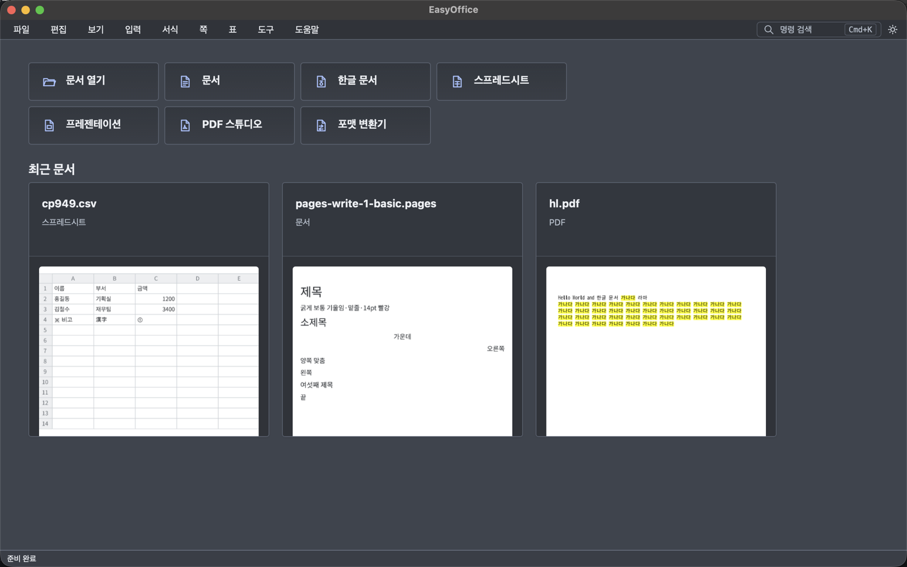

# EasyOffice

**문서·시트·슬라이드·PDF·한글을 한 앱에서 여는 오프라인 올인원 오피스**

EasyOffice는 문서·스프레드시트·프레젠테이션·PDF·한글(HWP/HWPX) 파일을 한 앱에서 열고 편집하는 오프라인 데스크탑 앱입니다. macOS, Windows, Linux에서 실행합니다.

엔진은 Rust로 짜여 있고 화면은 [Tauri](https://tauri.app) v2 셸 위의 WebUI입니다. 한글 문서의 파싱과 렌더링은 [rhwp](https://github.com/edwardkim/rhwp)를 기반으로 합니다. 셸이 파일 열기, 저장, PDF 내보내기, 인쇄, 파일 연결 같은 OS 통합을 맡습니다.



## 할 수 있는 일

* 문서 편집 (DOCX, DOC, ODT, RTF, MD, TXT)
* 시트 편집: 내장 함수 313종, 피벗, 차트, 조건부 서식 (XLSX, XLS, ODS, CSV, TSV)
* 슬라이드 편집과 발표자 보기: 글상자·도형·그림·표·차트 개체 (PPTX, PPT, PPSX, ODP)
* PDF 보기와 편집: 주석, 쪽 편집, 원본 객체 보존 저장 (PDF)
* 한글 문서 열기와 편집 (HWP, HWPX, HWT, HWTX)
* BASE: 표·관계·수식과 데이터시트·보드·일정 보기를 갖춘 관계형 데이터베이스 (`.eobase`)
* BOARD: 도형·글·그림·차트·연결선을 놓는 무한 캔버스 (`.eoboard`)
* 코파일럿: 사용자가 등록한 AI 모델 서버에 연결하는 채팅 패널 (앱에 모델을 내장하지 않음)
* 20종 포맷 사이의 변환과 일괄 변환

Pages(`.pages`)는 읽기와 실험적 쓰기를 지원합니다. 포맷별 읽기·쓰기·보존 범위와 상한은 [docs/format-support.md](docs/format-support.md), 기능 명세는 [docs/product-spec.md](docs/product-spec.md)에 있습니다.

문서 처리는 모두 로컬에서 합니다. 네트워크를 쓰는 기능은 코파일럿 요청과 하루 1회 업데이트 확인뿐입니다.

## 다운로드

최신 릴리스는 아래 링크에서 받을 수 있습니다.

* [macOS 유니버설 (.dmg)](https://github.com/AquilaXk/easyoffice/releases/latest/download/EasyOffice-macos-universal.dmg)
* [Windows x64 (설치 프로그램)](https://github.com/AquilaXk/easyoffice/releases/latest/download/EasyOffice-windows-x64-setup.exe)
* [Linux x64 (.deb, Ubuntu/Debian 계열 권장)](https://github.com/AquilaXk/easyoffice/releases/latest/download/EasyOffice-linux-x64.deb)
* [Linux x64 (.rpm, Fedora/openSUSE 계열)](https://github.com/AquilaXk/easyoffice/releases/latest/download/EasyOffice-linux-x64.rpm)
* [Linux x64 (AppImage, portable)](https://github.com/AquilaXk/easyoffice/releases/latest/download/EasyOffice-linux-x64.AppImage)
* [Linux arm64 (.deb, Ubuntu/Debian 계열)](https://github.com/AquilaXk/easyoffice/releases/latest/download/EasyOffice-linux-arm64.deb)

받은 파일은 [SHA256SUMS.txt](https://github.com/AquilaXk/easyoffice/releases/latest/download/SHA256SUMS.txt)의 체크섬과 비교할 수 있습니다.

전체 릴리스는 [GitHub Releases](https://github.com/AquilaXk/easyoffice/releases)에서 확인할 수 있습니다.

## 설치 유의사항

### macOS

macOS 빌드는 아직 Apple Developer ID로 서명·공증하지 않아 처음 실행할 때 Gatekeeper가 막습니다. 한 번만 허용하면 됩니다.

1. Finder에서 `/Applications`의 EasyOffice를 우클릭(또는 Control-클릭)해 `열기`를 고르고, 대화상자에서 다시 `열기`를 누릅니다.
2. macOS 15에서는 한 번 열기를 시도한 뒤 `시스템 설정 > 개인정보 보호 및 보안`에서 `그래도 열기`를 누릅니다.
3. 앱이 손상되었다고 표시되면 격리 속성을 한 번 제거합니다.

```sh
xattr -dr com.apple.quarantine /Applications/EasyOffice.app
```

### Windows

Windows 빌드는 아직 서명되지 않아 SmartScreen에서 "Windows의 PC 보호" 경고가 뜰 수 있습니다. `추가 정보`를 누른 뒤 `실행`을 선택합니다. 브라우저가 다운로드를 막으면 다운로드 목록에서 먼저 `유지`를 선택합니다. 의심스러우면 `Get-FileHash .\EasyOffice-windows-x64-setup.exe` 결과를 `SHA256SUMS.txt`와 비교합니다.

### Linux

Linux에서는 배포판에 맞는 네이티브 패키지를 우선 사용해 주세요. 한글 입력기와 WebKitGTK 런타임은 배포판이 제공하는 것을 쓸 때 가장 안정적입니다. arm64 Linux는 Ubuntu/Debian 계열 `.deb`만 제공합니다.

```sh
sudo apt install ./EasyOffice-linux-x64.deb   # Ubuntu, Debian
sudo dnf install ./EasyOffice-linux-x64.rpm   # Fedora
```

AppImage는 설치가 필요 없지만 `chmod +x EasyOffice-linux-x64.AppImage` 뒤에 실행하고, `libfuse2` 패키지가 있어야 합니다. 일부 Wayland·IME 환경에서는 한영 전환이나 창 표시가 불안정할 수 있어 네이티브 패키지를 쓸 수 없을 때만 권장합니다. 패키지는 glibc 2.35 이상과 WebKitGTK 4.1이 필요합니다(Ubuntu 22.04 이상, Debian 12 이상).

## 개발하기

```sh
node scripts/checkout-rhwp.mjs && node scripts/build-hwp-studio.mjs   # 한글 편집기 번들 준비
cargo run -p easyoffice-desktop                                        # 데스크톱 셸 실행
cargo run -p easyoffice-app -- --self-test                             # 엔진 자체 시험과 벤치마크
```

Rust는 `.github/rust-toolchain-version`의 1.93.1을 씁니다. 검증 명령 전체, 플랫폼별 패키지 빌드, 오픈소스 이식 규칙은 [개발 문서](docs/DEVELOPMENT.md)에, 구조는 [아키텍처](docs/architecture.md)에, 측정값은 [성능 문서](docs/performance.md)에 있습니다.

## 문제 신고

버그는 [이슈 양식](https://github.com/AquilaXk/easyoffice/issues/new/choose)으로 신고해 주세요. 기능 요청과 PR은 받지 않습니다. 자세한 내용은 [CONTRIBUTING.md](CONTRIBUTING.md)에, 보안 문제 신고는 [SECURITY.md](SECURITY.md)에 있습니다.

## Credits

EasyOffice는 [rhwp](https://github.com/edwardkim/rhwp)(MIT)를 기반으로 합니다. HWP 엔진을 공개해 주신 개발자분께 감사드립니다. 가져다 쓴 코드의 출처와 라이선스는 [THIRD_PARTY_NOTICES.md](THIRD_PARTY_NOTICES.md)에 있습니다.

License: Apache-2.0
