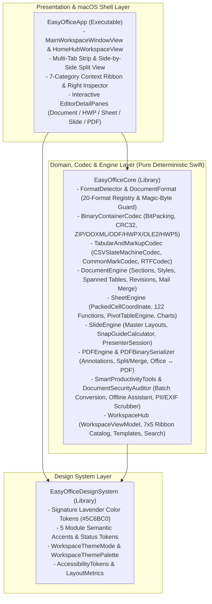

# EasyOffice 시스템 아키텍처 (System Architecture)

이 문서는 `EasyOffice` (`v1.0.0`)의 모듈 계층 구조, 비트 수준 컨테이너 코덱, 데이터 흐름, Fail-Closed 보안 경계, 결정론적 테스트 및 macOS 릴리스 패키징 아키텍처를 설명합니다.

---

## 1. 모듈 계층 구조 (Swift Package Architecture)



### 디렉터리 구조 (Directory Layout)

```text
EasyOffice/
├── Package.swift                                  # Swift 6 패키지 매니페스트 (macOS 14+)
├── Sources/
│   ├── EasyOfficeDesignSystem/                    # 시그니처 라벤더 디자인 시스템 및 레이아웃 토큰
│   │   └── DesignTokens.swift                     # RGBColorToken, WorkspaceThemeMode, AccessibilityTokens
│   ├── EasyOfficeCore/                            # 순수 결정론적 오피스 엔진, 코덱 및 스마트 생산성 코어
│   │   ├── DocumentFormat.swift                   # 20종 지원 포맷 레지스트리 및 ContainerFamily 메타데이터
│   │   ├── FormatDetector.swift                   # 매직 바이트 시그니처 검증 및 Fail-Closed 가드
│   │   ├── BinaryContainerCodec.swift             # BitPacking, Slicing-by-8 CRC32Calculator, ZipContainerCodec, XMLSanitizer
│   │   ├── StandardZipOfficeCodecs.swift          # OOXMLContainerCodec, ODFContainerCodec, HWPXContainerCodec
│   │   ├── OLE2AndLegacyOfficeCodecs.swift        # OLE2ContainerCodec, HWP5BinaryCodec, LegacyOLE2OfficeCodec (.doc/.xls/.ppt)
│   │   ├── TabularAndMarkupCodec.swift            # CSVStateMachineCodec, CommonMarkCodec, RTFCodec
│   │   ├── DocumentEngine.swift                   # 워드/한글(HWP/HWPX) 문서 모델, 인라인 런/이미지, 표 수식, 변경 추적, 메일 머지
│   │   ├── SheetEngine.swift                      # PackedCellCoordinate, FormulaAST, CellStyle, 다중 시트, evaluateGrid
│   │   ├── SheetBuiltInFunctions.swift            # 122종 스프레드시트 내장 함수 평가기 (수학·통계·논리·참조·텍스트·재무·날짜)
│   │   ├── SheetAnalyticsAndPivot.swift           # PivotTableEngine, SheetChartBuilder, 조건부 서식 및 유효성 검사
│   │   ├── SlideEngine.swift                      # 슬라이드/마스터, SnapGuideCalculator, PresenterSession 엔진
│   │   ├── PDFEngine.swift                        # 다중 페이지 PDF 분할/병합, 주석, 북마크, 양방향 변환 엔진
│   │   ├── PDFBinarySerializer.swift              # ISO 32000-1 바이트 정밀 xref 직렬화, 다중 줄 가시 스트림 및 PDFKit 브리지
│   │   ├── SmartProductivityTools.swift           # 일괄 변환 오케스트레이터
│   │   ├── DocumentSecurityAuditor.swift          # 컨테이너 보안 감사기, 4대 모델 PII 비식별화 및 이미지 EXIF 제거기
│   │   ├── LocalSmartAssistant.swift              # 100% 오프라인 스마트 문서 보조 도구 (요약, 문장 진단, 액션 추출, LCS 비교)
│   │   ├── WorkspaceHub.swift                     # WorkspaceViewModel, Undo Coalescing, 파일 I/O, 찾기 및 바꾸기
│   │   └── WorkspaceRibbonCommandRouter.swift     # 140종 컨텍스트 리본 도메인 명령 라우터 (Zero-Slop 상태 변이)
│   └── EasyOfficeApp/                             # macOS 네이티브 SwiftUI + AppKit 애플리케이션
│       ├── EasyOfficeApp.swift                    # @main 앱 엔트리포인트 및 메뉴바 커맨드 (열기/저장/인쇄/찾기/복사/붙여넣기)
│       ├── WorkspaceViews.swift                   # 통합 타이틀바, 멀티 탭, 리본, 찾기/바꾸기 바, 스플릿 뷰, 좌/우 인스펙터
│       ├── HomeHubAndSmartViews.swift             # 홈 허브, 포맷 일괄 변환 스튜디오, 오프라인 스마트 문서 보조 스튜디오
│       ├── EditorDetailPanes.swift                # Document/HWP 인라인 런/이미지 편집기 및 Sheet 다중 시트/셀 서식 그리드
│       └── SlideAndPDFDetailPanes.swift           # Slide 드래그/리사이즈 스테이지 및 PDF Studio (PDFKit 메모이제이션 뷰)
├── Tests/
│   └── EasyOfficeTests/                           # 결정론적 단위·보안·UI 패리티 및 벤치마크 검증 스위트
│       ├── EasyOfficeTests.swift                  # 디자인 토큰, 포맷 카탈로그 및 기본 엔진 검증
│       ├── BinaryContainerCodecTests.swift        # BitPacking, CRC32, ZIP/OLE2/HWP5/CSV/MD/RTF 및 보안 가드 검증
│       ├── EditorEnginesParityTests.swift         # 122종 시트 함수, 피벗/차트, 문서/HWP, 슬라이드, PDF 패리티 검증
│       ├── SmartProductivityToolsTests.swift      # 일괄 변환, 오프라인 스마트 보조 도구 및 보안 감사기 검증
│       ├── PiiScrubAndSecurityCompletenessTests.swift # 3대 엔진 공통 PII 벡터, 이미지 EXIF 제거 및 Mirror 전수 검증
│       ├── WorkspaceUIParityTests.swift           # 스플릿 뷰, 7x5 리본 매트릭스, WCAG AA 및 접근성 검증
│       └── CommercialParityBenchmarkTests.swift   # 20종 포맷 라운드트립 매트릭스 및 비트 수준 처리량 벤치마크
├── Cargo.toml                                     # Rust 멀티 크레이트 워크스페이스 매니페스트 (macOS / Windows / Linux 공통 코어)
├── crates/
│   ├── easyoffice-formats/                        # 20종 포맷 시그니처 검증, ZIP/OLE2/HWP5/XML 보안 가드, CSV/MD/PDF 코덱
│   ├── easyoffice-sheet/                          # 64-bit 패킹 셀 좌표, 순환 참조 탐지 수식 파서/평가기, 피벗 요약 엔진
│   ├── easyoffice-layout/                         # 시그니처 라벤더 토큰, A4 다단/원고지, KS X 6101 공문서, 슬라이드/PDF 레이아웃
│   ├── easyoffice-app/                            # 15종 IPC 라우터, 루프백 HTTP 서버(--serve), C-ABI FFI, WebUI(ui/)
│   └── easyoffice-desktop/                        # Windows 데스크톱 셸(Tauri v2·WebView2): EasyOffice.exe, NSIS 설치 프로그램
├── scripts/
│   ├── check-repo-hygiene.mjs                     # 외부 서비스명·AI 흔적·수치 정합성·XSS·데스크톱 셸 권한 가드
│   ├── generate-desktop-icons.mjs                 # 파비콘 디자인 기반 Windows 앱 아이콘(PNG/ICO) 결정론적 생성기
│   ├── verify-macos-plist.mjs                     # LaunchServices 20종 확장자 Info.plist 검증기
│   └── package-macos-release.sh                   # EasyOffice.app / .dmg / .zip / SHA256SUMS 생성기
├── docs/
│   ├── policy-decisions.md                        # 정책 결정 기록 (SSOT)
│   ├── design-system.md                           # 시그니처 라벤더 UI/UX 디자인 시스템
│   ├── product-spec.md                            # 올인원 오피스 통합 기능 명세
│   └── architecture.md                            # 시스템 아키텍처 문서
└── .github/
    ├── release.yml                                # GitHub Release 노트 자동 분류 설정
    ├── PULL_REQUEST_TEMPLATE.md                   # 자기완결 PR 표준 템플릿
    ├── ISSUE_TEMPLATE/                            # Epic / Task / Bug 이슈 폼 템플릿
    └── workflows/
        ├── ci.yml                                 # 위생 가드 + macOS Swift/Rust + Windows 엔진·데스크톱 셸·설치 프로그램 게이트
        ├── automerge.yml                          # automerge 라벨 기반 스쿼시 병합 및 이슈 자동 종료
        └── release.yml                            # macOS .app/.dmg/.zip, Windows 설치 프로그램 및 개발자용 CLI 프리뷰 발행
```

---

## 2. 크로스플랫폼 Rust 멀티 크레이트 코어 및 루프백 WebUI 서버 아키텍처

macOS, Windows, Linux 데스크톱 환경에서 동일한 문서 포맷 검증, 수식 계산, 조판 레이아웃, Fail-Closed 보안 불변식을 공유하기 위해 외부 런타임 의존성이 없는 순수 Rust 표준 라이브러리(`std`) 기반 4개 워크스페이스 크레이트와 로컬 루프백 WebUI 계층을 제공합니다.

1. **`crates/easyoffice-formats` (20종 포맷 레지스트리·RFC 1951/1950 DEFLATE·Slicing-by-8 CRC-32·SWAR UTF-16LE 코덱)**
   - 20종 `DocumentFormat` 및 `ContainerFamily` 메타데이터, 확장자-매직 바이트(`PK\x03\x04`, `\xD0\xCF\x11\xE0\xA1\xB1\x1A\xE1`, `%PDF-`, `{\rtf1`, UTF-8) 교차 검증(`FormatDetector::detect`, 최대 입력 `512 MiB`)을 수행합니다.
   - `IeeeCrc32`(`crc32.rs`)는 `static` slicing-by-16 테이블로 16바이트 단위 스칼라 CRC-32를 계산하고, 64바이트 이상 입력은 실행 시간 CPU 검출로 x86_64 PCLMULQDQ 폴딩·aarch64 CRC 명령 경로를 쓰며(미지원 CPU는 스칼라 폴백, `unsafe`는 `#[target_feature]` 함수 둘로 한정, PD-082), `deflate` 모듈은 64비트 워드 리필 `BitReader`, 9비트 1단계 `fast_lut` 고정/동적 허프만 디코더, `distance == 1` 바이트 반복(`out.resize`) 및 비겹침(`out.extend_from_within`) 고속 경로, 8바이트 `u64` SWAR XOR LZ77 매처, $O(1)$ `LENGTH_CODE_LUT`·`DIST_CODE_LUT`, RFC 1950 `NMAX = 5552` 지연 모듈로 `adler32` 및 `deflate_zlib`·`inflate_zlib`을 제공합니다.
   - `ZipSecurityGuard::validate_archive_entries`는 엔트리 수(`4,096`), 단일 엔트리(`128 MiB`), 전체 해제 용량(`512 MiB`), 압축비(`100:1`), 경로 순회(`..`, 선행 `/`, `\`, NUL 바이트, Windows 드라이브 문자 `C:`)를 검증합니다.
   - `Ole2SecurityGuard`와 `Ole2ContainerCodec`은 `SectorBitset`(`Vec<u64>`, 1비트=1섹터)으로 힙 할당 없이 FAT 체인 순환 참조를 $O(1)$에 탐지하고, HWP 5.0 `FileHeader` 암호화(`0x02`)·배포용 문서(`0x04`) 비트를 차단합니다. `LegacyOle2Codec::pack_xls`는 `HashMap<String, u32>`로 BIFF8 공유 문자열 테이블(SST)을 $O(1)$에 인덱싱합니다.
   - `rtf_xml_helpers`는 64비트 SWAR ASCII 배치 경로 기반 `decode_utf16le_swar`·`encode_utf16le_swar`와 단일 패스 엔티티 디코더 `unescape_xml_single_pass`를 제공하며, `XmlSanitizer`(`<!ENTITY` 및 외부 DTD `SYSTEM`/`PUBLIC`/`[` 차단), `CsvCodec`(RFC 4180 상태 기계), `CommonMarkCodec`, `PdfSerializer`(`%PDF-1.4` 바이트 오프셋 `xref` 직렬화)를 포함합니다.
   - 출력 작성기는 각 규격의 필수 파트를 기록합니다(`PD-071`): `ooxml_presentation`(PPTX 테마·`p:clrMap`·노트 슬라이드·`docProps/core.xml`), `ooxml_shared_parts`(코어 속성, DrawingML 테마, DOCX `w:tblPr`/`w:tblGrid`), `hwpx_codec`·`hwpx_parts`(HWPX `header.xml` 글꼴·모양·스타일, `version.xml`, `settings.xml`, `hp:secPr`, `hp:p > hp:run > hp:tbl`), `pdf_writer`(사전 정의 CJK 글꼴 `HYGoThic-Medium`/`UniKS-UCS2-H`, UTF-16BE+BOM `/Title`). XLSX 수식 캐시값은 순환 의존을 피하기 위해 앱 계층(`convert_ipc::compute_xlsx_formula_cache`)이 `easyoffice-sheet`로 계산해 `OoxmlCodec::pack_xlsx_multi_with_formula_cache`에 전달하며, `DocumentFormat::output_compatibility()`는 `.doc`/`.ppt` 출력을 호환성 제한(`Limited`)으로 보고합니다.
   - `crates/easyoffice-formats/tests/output_container_spec_validity.rs`는 출력 패키지를 풀어 필수 파트·요소의 존재와 비표준 속성의 부재를 검증합니다.
   - `rich_document`의 `RichDocument`(문단 런 굵게·기울임·밑줄·취소선·크기(반포인트)·글꼴·글자 색·형광펜(`PD-077`, 쓰기는 `rich_run_writers`, RTF 읽기는 `rich_read_rtf`), 정렬, 제목 수준, 목록 + 문서 내 위치의 표 블록)는 구조화 저장 경로의 중간 모델이며(`PD-073`), `rich_writers`와 `HwpxCodec::pack_rich`가 블록 순서대로 DOCX(`w:rPr`/`w:pPr`/`w:pStyle`, `word/styles.xml`), HWPX(서식별 `charPr`/`paraPr`, `개요 N` 스타일), ODT(자동 스타일), RTF(제어어), Markdown(`**`/`*`/`~~`/`#`), TXT·PDF(순서 보존 텍스트)를 기록합니다. 그 밖의 형식은 평탄화한 `UniversalDocumentModel`로 기록하고, 표 수식(`=SUM(ABOVE)` 등)은 `evaluate_table_formulas`가 계산값으로 바꿉니다.
2. **`crates/easyoffice-sheet` (64-bit 패킹 좌표·사전 컴파일 AST·비트셋 DAG 평가기)**
   - `PackedCellCoordinate`는 `(row, col)` 32비트 쌍을 단일 `u64`에 패킹하고(`MAX_ROWS = 1,000,000`, `MAX_COLS = 16,384`), `CellRange::expand`는 단일 범위 확장 상한(`100,000`셀)을 강제합니다. 범위 참조 자체는 시트 경계까지 허용하며, 집계·조건부 집계 함수는 채워진 셀만 순회하고 조밀 순회는 평가 단계 예산(`MAX_EVAL_STEPS`)으로 제한합니다. 순환 참조 셀은 표준 오류값 `#NUM!`로 표시되고 IPC 응답의 `circular` 플래그로 별도 보고됩니다.
   - `tokenize_formula`는 `Vec<char>` 할당 없는 제로카피 바이트 슬라이스 스캐너로 동작하며, `SheetEngine::set_cell`이 수식 입력 시점에 `compiled_asts`로 AST를 사전 컴파일합니다.
   - `EvalContext`는 시트 ID(대소문자 무시 16비트 FNV-1a)와 셀 좌표로 메모를 주소 지정합니다. `memo.rs`의 `MemoTable`은 기본 시트 앞 16열을 32x16 페이지 슬롯 인덱스(해시 없음)로, 나머지는 시드된 곱셈 해셔 맵으로 저장하고 방문 집합(1비트/셀)으로 순환 참조 탐지(`FormulaError::Cycle`)를 $O(1)$에 수행하며, 재귀 상한은 `MAX_RECURSION_DEPTH`로 유지합니다. `dag.rs`는 명시적 스택 DFS 사전 평가(2비트/셀 상태 비트셋, `u16` 시트 슬롯, 열별 수식 인덱스로 큰 범위의 빈 셀·리터럴 건너뛰기)와 편집 시 무효화되는 `RecalcPlan`(후위 순서 캐시)을 담당합니다(PD-082). ECMA-376 호환 122종 내장 함수, 다중 시트 워크북(`WorkbookEngine`), `PivotTableSummary` 집계를 제공합니다.
3. **`crates/easyoffice-layout` (시그니처 라벤더 토큰·5대 모듈 도메인 엔진·조판 레이아웃)**
   - `SignatureLavenderPalette`(`#5C6BC0` Primary Accent, `#F7F8FC` Light Canvas, `#141724` Dark Canvas), 플랫폼 렌더러 식별자(`MacOsWkWebView` / `WindowsWebView2` / `LinuxWebView`), 리본 레이아웃 모드(`RibbonLayoutStyle`), 모듈별 자동 개체 도구 배지(`ContextualObjectToolKind`)를 정의합니다.
   - `DocumentPageLayout`(A4 가로/세로 스왑, 1~4단 다단 폭 계산, 200자 원고지 그리드, KS X 6101 행정 공문서 헤더 및 결재란), `DocumentDomainEngine`(병합 표 모델 `DocumentTableModel` 및 `=SUM(ABOVE)`·`=AVERAGE(LEFT)` 표 수식, 변경 내용 추적 `RevisionRecord`, 각주·미주 `FootnoteEntry`, 1~3단계 자동 목차 생성, `{{필드}}` 메일 머지), `SlideDomainEngine`(5종 마스터 레이아웃, 전환 타이밍, 발표자 레이저 포인터·자유곡선 펜 `PresenterSessionState`), `PdfDomainEngine`(90도 페이지 회전, 페이지 분할·병합, 결재 스탬프, 워터마크, AcroForm 위젯)을 제공합니다.
4. **`crates/easyoffice-app` (15종 IPC 라우터·루프백 HTTP 서버·결정론적 벤치마크 하니스·140종 리본·C-ABI FFI·WebUI)**
   - `RibbonCommandRouter`가 7개 카테고리 × 20개 명령(`140`종) 카탈로그와 64단계 `UndoRedoStack`을 제공하며, `LocalSmartAssistant`(TF 가중 핵심 문장 요약, 문장 진단, 액션 아이템 추출, LCS 문서 비교), 선형 시간($O(n)$) `PiiScrubber`(주민등록번호·외국인등록번호·휴대전화·유니코드 IDN 이메일·신용카드(Luhn 검증)·은행 계좌·여권·운전면허·사업자등록번호 마스킹 및 실제 제거된 메타데이터 필드 보고), `benchmark::run_deterministic_benchmarks`, C-ABI 브리지(`easyoffice_ffi_version`, `easyoffice_ffi_dispatch_json`, `easyoffice_ffi_free_string`)를 내장합니다.
   - `EasyOfficeIpcRouter::dispatch`가 `get_workspace_bootstrap`, `detect_format`, `evaluate_sheet`, `evaluate_workbook_formula`, `compute_layout`, `audit_security`, `execute_ribbon_command`, `undo_ribbon_command`, `redo_ribbon_command`, `switch_ribbon_style`, `run_smart_assistant`, `scrub_pii`, `convert_document_format`, `get_ribbon_category_commands`, `run_engine_benchmark` 총 15종 명령을 라우팅하며, 리본 서식 상태와 실행 취소/다시 실행 스택은 `ribbon_session.rs`가 클라이언트 `sessionId`(WebUI 페이지 로드마다 `crypto.getRandomValues`로 생성, 생략 시 `default` 세션) → 모듈(`DOC`/`HWP`/`SHEET`/`SLIDE`/`PDF`) 2단 키로 분리 보관하고(최대 32세션 LRU 축출), `undo_ribbon_command`/`redo_ribbon_command`는 페이로드의 `module`(생략 시 세션의 마지막 실행 모듈) 스택만 되돌립니다(PD-069). `convert_document_format`은 구조화 필드 `blocks`/`sheets`/`slides`(`convert_structured.rs`, 사용자 텍스트를 마크업으로 해석하지 않음)를 우선 처리하고, 이 필드가 없을 때만 하위 호환용 텍스트 마크업 `body`를 해석합니다. `sheets`는 모든 시트를 `WorkbookEngine`으로 함께 계산해 시트별 XLSX 수식 캐시를 만듭니다(PD-073). 같은 명령이 실제 원본 파일도 받아(`sourceBase64`, `convert_open.rs`) `"action":"decode"`이면 구조화 편집기 모델(`blocks`/`sheets`/`slides` + `module`·`warnings`)을, 아니면 디코딩한 원본 바이트를 대상 형식으로 변환합니다(명령 수는 15종 그대로, PD-075). 디코딩은 `easyoffice-formats`의 `UniversalFormatConverter::decode_rich`(`rich_readers.rs`와 `rich_read_{ooxml,hwpx,odt,text}.rs`, 공용 `rich_xml.rs` 토크나이저)가 담당하며 모든 ZIP 경로에 압축 비율·항목·경로 순회와 XXE/DTD 가드를 적용합니다. WebUI는 새 `ui/file-open.js`가 파일 선택·끌어 놓기·`Ctrl+O`를 받아 단일 진입점 `openDocumentFromBytes`로 모델을 `ribbon-history.js` 스냅샷 복원(탭 제목 `tabTitles` 포함)으로 적재해 하나의 실행 취소 단위로 만듭니다. 슬라이드 모듈은 새 `ui/slide-studio.js`가 슬라이드 추가·복제·삭제·이동(끌어 놓기·`Alt+↑/↓`·우클릭 메뉴, 모두 실행 취소 스냅샷 경유), 디바운스 썸네일, 덱 화면 비율(16:9·4:3·A4)과 `F5`/`Shift+F5` 슬라이드 쇼(전체 화면 API 우선, 창 내 대체, 발표자 보기)를 담당하며 모델은 계속 `slideDeckState` 하나입니다(PD-080). `cargo run --release -p easyoffice-app -- --self-test`로 전 크레이트 통합 불변식과 5회 반복 `p50` 벤치마크 요약을 자체 검증합니다.
- WebUI 시트 편집기는 `ui/sheet-grid.js`(가상화 격자·열 너비·일반 숫자 서식), `ui/sheet-input.js`(준비/편집 모드·범위 선택·키보드·마우스·IME·집계), `ui/sheet-clipboard.js`(TSV 클립보드와 상대 참조 이동), `ui/sheet-ops.js`(정렬·조건부 서식·요약)로 나뉘며 `ui/sheet-controller.js`가 모델(`sheetDataStore`)·확정/재계산/실행 취소를 소유합니다. 논리 주소는 `XFD1048576`까지이고 DOM에는 보이는 창만 만들어집니다(PD-078).
   - `http_server` 모듈(`--serve <port>`)은 `127.0.0.1` 루프백 전용 HTTP 서버를 구동하며, 모든 응답 상태코드(`200`, `400`, `403`, `404`, `413`, `500`, `503`)에 `Content-Security-Policy` 헤더(`default-src 'self'`)를 강제하고 `ConnectionSlotGuard`(동시 32슬롯 상한, 슬롯 포화 시 즉시 `503` 반환, 패닉 발생 시 `catch_unwind` 복구)와 연결당 3초 데드라인으로 Slowloris 점유를 방어하며, 요청 본문 상한은 `POST /api/ipc` 16MiB(`MAX_IPC_HTTP_BODY_BYTES`), 그 밖의 경로 1MiB(`MAX_HTTP_BODY_BYTES`)입니다. 프로덕션 `ui/` 계층은 엔진 미연결 환경에서 모의 응답으로 대체하지 않고 즉시 실행을 거부합니다. `--serve`는 개발·미리보기 경로이며, Windows 사용자 배포는 아래 데스크톱 셸을 씁니다.
5. **`crates/easyoffice-desktop` (Windows 데스크톱 셸: Tauri v2·WebView2, `EasyOffice.exe`, PD-074)**
   - `tauri.conf.json`의 `frontendDist`(`../easyoffice-app/ui`)를 빌드 시 실행 파일에 포함하고, 창은 내장 출처(`http://tauri.localhost`)만 표시합니다(`on_navigation`이 다른 URL 이동을 거부). HTTP 서버, 브라우저, 원격 콘텐츠를 쓰지 않습니다.
   - 셸 명령은 두 개뿐입니다. `ipc_dispatch(command, payload)`는 `EasyOfficeIpcRouter::dispatch`의 15종 명령을 프로세스 안에서 호출해 JSON 문자열을 돌려주고, 실패 시 `--serve`의 HTTP 400 본문과 같은 `{"status":"error","message"}`로 거부합니다. `save_document_file(fileName, base64)`는 Rust에서 기본 저장 대화상자(`tauri-plugin-dialog`)를 열고, 사용자가 고른 경로에 임시 파일 기록 후 이름 바꾸기로 저장합니다. WebView는 파일 이름만 제안하며 경로를 넘기지 않습니다.
   - `build.rs`의 `AppManifest`가 두 명령을 기본 거부로 선언하고, `capabilities/main-window.json`이 `main` 창에만 `allow-ipc-dispatch`·`allow-save-document-file`을 허용합니다. core·shell·fs·http·dialog 권한은 WebView에 주지 않습니다. CSP는 WebUI와 같은 `default-src 'self'`에 셸 IPC 출처(`connect-src 'self' ipc: http://ipc.localhost`)만 더합니다.
   - UI의 `ui/desktop-bridge.js`는 `window.__TAURI_INTERNALS__.invoke`가 있으면 셸 명령을, 없으면 `fetch("/api/ipc")`와 Blob 다운로드를 씁니다. 저장 취소·실패는 기존 저장 상태 표시(`문서 저장 취소`/`문서 저장 실패`)로 보고합니다.
   - `EasyOffice.exe --smoke`는 실제 창을 띄워 내장 WebUI가 `get_workspace_bootstrap` → `get_ribbon_category_commands` IPC 왕복을 마치면 종료 코드 0으로 끝납니다(CI 스모크 테스트).

---

## 3. 보안 및 Fail-Closed 경계 (Security Boundaries)

1. **입구 시그니처 검증 (`FormatDetector`)**
   - 모든 파일 입력은 확장자와 무관하게 바이트 헤더(`PK\x03\x04`, `\xD0\xCF\x11\xE0\xA1\xB1\x1A\xE1`, `%PDF-`, UTF-8 유효성)를 대조합니다.
   - 빈 파일(`emptyPayload`), 최대 허용 크기 초과(`payloadTooLarge`), 확장자-헤더 불일치(`signatureMismatch`)는 즉시 `EasyOfficeError`를 던져 차단합니다.
2. **ZIP/OLE2 압축 폭탄·경로 순회·XXE 원천 차단 (`ZipContainerCodec`, `OLE2ContainerCodec`, `XMLSanitizer`)**
   - `ZipContainerSecurityPolicy`는 엔트리 수 상한(`4,096`), 단일 엔트리 해제 상한(`128 MiB`), 전체 해제 상한(`512 MiB`), 최대 압축 비율(`100:1`)을 강제하며, `..`·선행 `/`·`\`·NUL 바이트 경로를 `EasyOfficeError.securityViolation`으로, 압축 비율/용량 초과를 `EasyOfficeError.decompressionBombDetected`로 즉시 차단합니다.
   - `XMLSanitizer`는 컨테이너 내부 XML 파싱 전 `<!ENTITY` 선언 및 외부 DTD(`SYSTEM`/`PUBLIC`/내부 서브셋 `[`)를 검사하여 `EasyOfficeError.xxeOrExternalEntityDetected`로 차단합니다.
   - `OLE2ContainerCodec`과 `HWP5BinaryCodec`은 512바이트 섹터 FAT 체인 순환 루프를 방어하고, `FileHeader` 암호화 비트(`0x02`) 및 배포용 문서 비트(`0x04`) 감지 시 `EasyOfficeError.encryptedDocumentUnsupported`로 Fail-Closed 처리합니다.
3. **수식·범위 경계 및 스크립트 격리 (`SheetEngine`)**
   - 스프레드시트 수식 평가기는 외부 셸 호출이나 네트워크 접근 권한이 없는 순수 메모리 내 평가기로 동작하며, `PackedCellCoordinate` 방문 집합과 재귀 상한(`maxRecursionDepth = 64`), 단일 범위 확장 상한(`maxExpandedCellCount = 100,000`)으로 무한 루프와 메모리 고갈을 차단합니다.
4. **메타데이터·이미지 EXIF 비식별화 및 제로 외부 텔레메트리 (`DocumentSecurityAuditor`, `LocalSmartDocumentAssistant`)**
   - 문서·시트·슬라이드·PDF 4대 도메인 모델의 모든 사용자 텍스트 필드와 첨부 JPEG(`APP1..APP15`, `COM`)·PNG(`tEXt`, `zTXt`, `iTXt`, `eXIf`, `tIME`)·TIFF(EXIF/GPS/XMP 태그) 바이너리 메타데이터 비식별화는 100% 온디바이스 결정론적 알고리즘으로 수행되며 외부 네트워크 호출이나 텔레메트리 전송이 없습니다.

---

## 4. macOS 및 Windows 릴리스 패키징 파이프라인 (`scripts/package-macos-release.sh`, `.github/workflows/release.yml`)

GitHub Release 발행 시 macOS(`release-macos`)와 Windows(`build-windows-release`) 병렬 파이프라인이 다음 단계를 결정론적으로 수행합니다.
1. `swift build -c release`로 macOS 앱을, Tauri CLI(`npx @tauri-apps/cli@2 build --bundles nsis`)로 Windows 데스크톱 셸 `EasyOffice.exe`와 NSIS 설치 프로그램을, `cargo build -p easyoffice-app --release`로 개발자용 CLI를 컴파일합니다. Windows 설치 프로그램은 사용자 단위 설치, 시작 메뉴 바로 가기, 제거 프로그램을 제공하며 문서 파일 연결은 파일 열기 지원(#111) 전까지 등록하지 않습니다.
2. 표준 macOS 애플리케이션 번들 구조(`EasyOffice.app/Contents/{MacOS,Resources,Info.plist,PkgInfo}`)를 생성하고 20종 전체 지원 확장자에 대한 문서 연결(`CFBundleDocumentTypes`)과 고해상도 Retina 속성(`NSHighResolutionCapable`)을 주입한 뒤 `scripts/verify-macos-plist.mjs`와 `plutil -lint`로 검증합니다.
3. 코드 서명(`codesign --force --deep --sign -` 또는 Developer ID 인증서) 및 번들 구조 검증을 수행합니다. 애드혹 서명 배포본은 최초 실행 전 `xattr -dr com.apple.quarantine /Applications/EasyOffice.app`으로 격리 속성을 해제할 수 있습니다.
4. macOS 배포용 디스크 이미지(`EasyOffice-<version>-macos.dmg`), 압축 아카이브(`EasyOffice-<version>-macos.zip`), `SHA256SUMS.txt`와 Windows x64 설치 프로그램(`EasyOffice-<version>-windows-x64-setup.exe`), 개발자용 CLI 및 루프백 WebUI 서버 프리뷰 아카이브(`EasyOffice-<version>-windows-x64-cli-serve-preview.zip`), `SHA256SUMS-windows-x64.txt`를 빌드 대상 커밋 SHA(`--target`)에 고정하여 GitHub Release 자산으로 업로드합니다.

---

## 5. 서드파티 upstream 경계 (`third_party/rhwp`, PD-076)

HWP 엔진·편집기의 기반인 rhwp는 수정하지 않는 읽기 전용 서브모듈로만 가져옵니다. 고정 커밋·버전·sparse 목록은 `config/rhwp-upstream.json`이 기준이고, `scripts/verify-rhwp-upstream.mjs`가 `.gitmodules` URL, gitlink 커밋, 작업 트리 clean 상태, 버전 일치를 fail-closed로 검사합니다(체크아웃이 없는 CI 기본 상태에서도 통과). `scripts/checkout-rhwp.mjs`는 약 5.3 GB인 upstream을 얕은·부분 체크아웃으로만 받으며, 위생 가드(`scripts/check-repo-hygiene.mjs`)는 디스크 순회에서 `third_party/rhwp`(루트 기준) 하나만 제외합니다. 이 단계는 런타임 동작을 바꾸지 않으며, 고지는 `THIRD_PARTY_NOTICES.md`, 설계 전문은 `docs/rhwp-integration-design.md`에 있습니다.

### 5.1 HWP 편집기 자산: 벤더 WASM·오버레이 번들·글꼴 (PD-081)

- `vendor/rhwp-core/`는 고정 커밋에서 미리 빌드한 WASM 패키지(Rust 1.93.1, wasm-pack 0.14.0)이며 `PROVENANCE.json`의 파일별 크기·SHA-256을 `scripts/verify-rhwp-core.mjs`가 검사합니다. CI는 WASM을 빌드하지 않습니다.
- `apps/hwp-studio`는 `third_party/rhwp/rhwp-studio` 위의 임베드 전용 오버레이입니다(Vite 별칭 + `config/rhwp-studio-overrides.json`의 오버라이드 목록과 원본 해시). `scripts/build-hwp-studio.mjs`가 `npm ci --ignore-scripts`와 `vite build`로 `crates/easyoffice-app/ui/hwp-studio/`(추적하지 않는 생성물)를 만들고 `scripts/check-hwp-studio-bundle.mjs`가 외부 URL·`eval`·`__TAURI`·인라인 스타일/스크립트·벤더 WASM 불일치·크기 예산을 검사합니다. 번들은 아직 셸이나 `--serve`에 내장되지 않으며(3단계), `scripts/hwp-studio-harness.mjs`가 단독으로 임베드 프로토콜과 편집 왕복을 검증합니다.
- `assets/fonts`는 SIL OFL 1.1 글꼴만 담고(`fonts.json`, `FONTS.md`, `licenses/`) `scripts/verify-fonts.mjs`가 라이선스·해시를 검사합니다. 위생 가드는 Git이 추적할 파일 기준으로 후보를 모으고 `vendor/rhwp-core`·`ui/hwp-studio`를 내용 검사에서 제외하는 대신 위 해시·정적 검사로 대체합니다.

- **한글 패널 임베딩 (PD-083)**: `ui/hwp-host.js`가 한글 모듈 첫 활성화 때 `#pane-hwp`에 `ui/hwp-studio` 번들을 `sandbox="allow-same-origin allow-scripts allow-modals"` iframe으로 지연 생성하고 MessagePort로 rhwp 임베드 프로토콜을 호출합니다(IPC 권한 없음). 데스크톱 셸은 번들을 `frontendDist`로 내장하고(번들이 없으면 `build.rs`가 빌드 실패, CI·릴리스는 `scripts/build-hwp-studio.mjs`를 Tauri 빌드 전에 실행) CSP에 `'wasm-unsafe-eval'`·`img-src data: blob:`·`frame-src 'self'`만 추가합니다. `--serve`는 `/hwp-studio/*`를 바이너리·정확한 MIME·전용 CSP로 제공하며(`src/hwp_bundle.rs`, 경로 순회 차단) 번들은 cargo 기능 `embed-hwp-studio`로 실행 파일에 내장하거나 디스크에서 읽습니다. 번들이 없으면 기존 텍스트 전용 편집기로 폴백합니다.
- **한글 열기·저장·자동 저장 (PD-085)**: `ui/hwp-session.js`가 한글 문서 수명주기를 소유합니다. `file-open.js`가 HWP 계열을 `detect_format`(이름 힌트+앞 16바이트) 검사 후 `loadFile`로 편집기에 넘기고(64 MiB, rhwp 실패 시 명시 안내가 붙은 텍스트 전용 디코드로 대체), 저장은 `exportHwp`/`exportHwpx` 바이트를 편집기의 `verifyBytes`(오버레이 확장 RPC, 버려지는 문서로 재파싱)로 검증한 뒤 기존 전달 경로로 내보내고 실제 성공 때만 `notifySaved`를 호출합니다. 수정 상태는 오버레이가 보내는 `dirty_changed`/`edited` 이벤트로 추적해 `workspace-session.js`의 이탈 경고에 합치고, 자동 저장은 IndexedDB(`easyoffice.hwp.autosave.v1`, 탭당 1건)에 디바운스로 쓰며 복원 전 `detect_format`으로 검증합니다.
