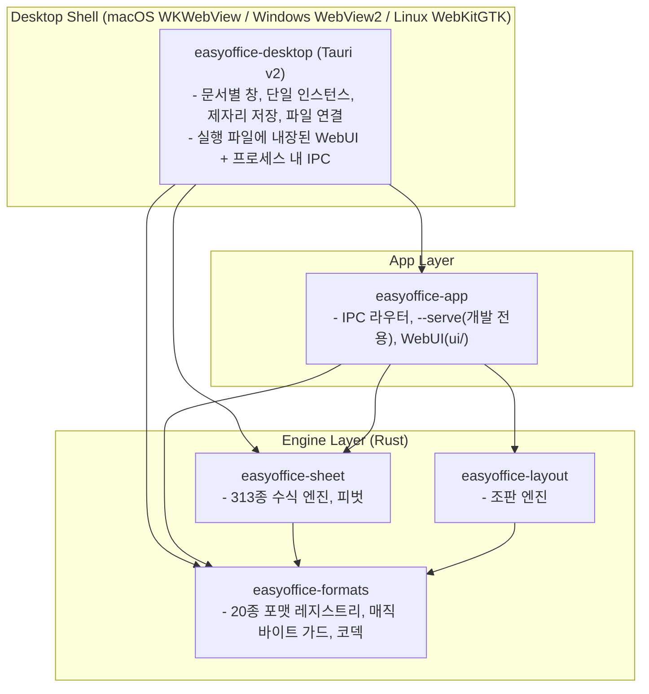

# EasyOffice 시스템 아키텍처 (System Architecture)

이 문서는 `EasyOffice` (`0.1.0`)의 크레이트 구조와 의존 정책, 비트 수준 컨테이너 코덱, 데이터 흐름, Fail-Closed 보안 경계, IPC·Tauri 셸, PDF 편집 워커 격리, 코파일럿 네트워크 경로, BASE·BOARD 패키지, 릴리스 패키징을 설명합니다. 근거 파일 경로를 항목마다 적었고, 결정 이력은 [policy-decisions.md](policy-decisions.md)에 있습니다.

마지막 코드 대조: 2026-11-20(`acf29cd5`).

---

## 1. 모듈 계층 구조 (Rust 멀티 크레이트 + Tauri 셸, PD-094)



### 디렉터리 구조 (Directory Layout)

```text
EasyOffice/
├── Cargo.toml                                     # Rust 멀티 크레이트 워크스페이스 매니페스트 (macOS / Windows / Linux 공통 코어)
├── crates/
│   ├── easyoffice-formats/                        # 20종 포맷 시그니처 검증(+ Pages(읽기, 실험적 쓰기 `pages_write`): IWA/Snappy 변형/protobuf 자체 디코더), ZIP/OLE2/HWP5/XML 보안 가드, CSV/MD/PDF 코덱
│   ├── easyoffice-sheet/                          # 64-bit 패킹 셀 좌표, 순환 참조 탐지 수식 파서/평가기, 피벗 요약 엔진
│   ├── easyoffice-layout/                         # 시그니처 라벤더 토큰, A4 다단/원고지, KS X 6101 공문서, 슬라이드/PDF 레이아웃
│   ├── easyoffice-app/                            # 15종 IPC 라우터, 루프백 HTTP 서버(--serve), C-ABI FFI, WebUI(ui/)
│   └── easyoffice-desktop/                        # 데스크톱 셸(Tauri v2, Windows WebView2 / macOS WKWebView): EasyOffice.exe + NSIS 설치 프로그램, EasyOffice.app + .dmg (PD-094)
├── apps/
│   ├── hwp-studio/                                # 고정된 rhwp 업스트림 위의 한글 편집기 오버레이(임베드 전용)
│   └── quicklook/                                 # macOS Finder 빠른 보기 확장과 C ABI 크레이트(별도 워크스페이스)
├── vendor/                                        # 패치한 사본: svg2pdf(RHWP_PATCHES.md), PDF 쪽 복사기(PATCHES.md, PD-266), rhwp WASM(PROVENANCE.json)
├── third_party/rhwp/                              # 고정 커밋의 얕은 sparse 체크아웃(추적하지 않음, PD-076)
├── scripts/
│   ├── check-repo-hygiene.mjs                     # 외부 서비스명·AI 흔적·수치 정합성·XSS·데스크톱 셸 권한 가드
│   ├── generate-desktop-icons.mjs                 # 파비콘 디자인 기반 데스크톱 앱 아이콘(PNG/ICO/ICNS) 결정론적 생성기
│   └── desktop-file-associations.mjs              # tauri.conf.json 파일 연결·macOS 번들 설정 정적 계약 (PD-094)
├── docs/
│   ├── policy-decisions.md                        # 정책 결정 기록 (SSOT)
│   ├── design-system.md                           # UI 디자인 기준 (참조 앱/rhwp-studio 토큰, PD-098)
│   ├── product-spec.md                            # 올인원 오피스 통합 기능 명세
│   ├── architecture.md                            # 시스템 아키텍처 문서
│   ├── DEVELOPMENT.md                             # 개발 환경·검증·이식 규칙
│   ├── format-support.md                          # 포맷별 지원 범위·상한
│   └── performance.md                             # 측정값과 병목
└── .github/
    ├── release.yml                                # GitHub Release 노트 자동 분류 설정
    └── workflows/
        ├── ci.yml                                 # Linux 공통 게이트(위생·WebUI·Rust fmt/clippy/test) + macOS 데스크톱 셸·.app·.dmg + Windows 엔진·데스크톱 셸·설치 프로그램, Rust 캐시 (PD-091)
        └── release.yml                            # macOS 유니버설 .dmg, Windows 설치 프로그램 및 개발자용 CLI 프리뷰 발행
```

### 1.1 크레이트 의존 정책 (PD-269, PD-101)

| 크레이트 | 역할 | 외부 의존 | 워크스페이스 내부 의존 |
| :--- | :--- | :--- | :--- |
| `easyoffice-formats` | 포맷 레지스트리, 컨테이너·문서 코덱, 보안 가드, `native_package.rs` | 있음(기반 코덱 크레이트, 아래) | 없음 |
| `easyoffice-sheet` | 수식 엔진, 피벗, 재계산 DAG | 없음(아직) | formats |
| `easyoffice-layout` | 쪽·슬라이드 조판 모델(`domain.rs`) | 없음(아직) | formats |
| `easyoffice-app` | IPC 라우터, 코파일럿 엔진, 변환·열기, `--serve`, WebUI(`ui/`) | 있음(SSE 해석 `sse-core`) | formats, sheet, layout |
| `easyoffice-desktop` | Tauri v2 셸, OS 통합, PDF 내보내기·편집, 코파일럿 HTTP 전송 | 있음(아래) | app, formats, sheet |

- **엔진 크레이트도 허용 라이선스(MIT, Apache-2.0, BSD, Zlib)의 유지되는 크레이트를 그대로 씁니다**(PD-269가 PD-053·PD-095의 무의존 방침을 대체). 같은 기능을 직접 짠 코드와 크레이트를 두 벌 두지 않고, 원본의 버그 수정과 사양 변경은 업데이트로 받습니다. 크레이트 버전은 데스크톱 셸과 rhwp가 이미 푸는 버전에 맞춰 `Cargo.lock`에 중복 버전이 늘지 않게 하고, 루트 `Cargo.toml`의 `[workspace.dependencies]`에서 한곳에서 정합니다.
- **크레이트는 얇은 어댑터 뒤에 둡니다.** 상한과 Fail-Closed(ZIP 폭탄·항목 수·총 해제 크기, 경로 순회·대소문자 충돌, XXE·DTD, JSON 깊이·크기)는 크레이트 바깥 래퍼에 남기고, 크레이트가 상한 없이 끝까지 읽는 경로(`zip`의 항목 읽기 등)는 쓰지 않거나 상한 있는 읽기로 감쌉니다. 1단계(PD-269)에서 바뀐 기반 코덱은 `formats`의 `crc32.rs`(crc32fast), `base64_codec.rs`(base64), `sha_digest.rs`(sha1·sha2), `cp949.rs`(문자 인코딩 크레이트), `deflate.rs`(DEFLATE·Adler-32 크레이트), `zip_codec.rs`(zip), `json_out.rs`(serde_json: JSON 출력의 이스케이프·직렬화 한곳, 입력 파서 `strict_json*.rs`는 보안 경계라 직접 유지)입니다. 2단계로 XLSX·XLS·ODS를 평가했으나 크레이트가 상한과 왕복 보존 항목을 다 지키지 못해 자체 코덱을 유지합니다(PD-269 7항). `app`의 SSE 해석은 `sse-core` 크레이트입니다. 3단계로 `xml_stream.rs`의 XML 스트림 읽기(XLSX·ODS·DOCX·ODT·PPTX·HWPX가 함께 씀)를 XML 읽기 크레이트 위의 어댑터로 바꿨습니다. 크레이트가 이벤트로만 주는 DOCTYPE은 래퍼가 거부하고, 이벤트 수(600만)와 중첩 깊이(100만) 상한, 속성 검사, 엔티티 규칙(5종과 XML 1.0 글자의 숫자 참조만 풀고 나머지는 그대로)은 래퍼에 남깁니다(PD-269 10항). 이어서 PDF, HWP·HWPX 순으로 바꿉니다.
- **외부 의존은 데스크톱 셸에만 둡니다**(PD-101). 이유는 PDF 글꼴 서브셋·`ToUnicode`, PDF 객체 복사, TLS, OS 창 같은 일을 자체 구현하면 이식 한도를 크게 넘기 때문입니다. 용도별로 묶으면 다음과 같습니다(`crates/easyoffice-desktop/Cargo.toml`).
  - 창·IPC·대화상자·단일 인스턴스·업데이트: Tauri v2와 플러그인.
  - 검색 가능한 PDF 내보내기와 카드 미리보기: SVG→PDF 변환, SVG 파서·래스터, 글꼴 DB, PDF 쓰기(PD-101, PD-142, PD-179).
  - PDF 스튜디오 편집: PDF 구문 읽기, 쪽 복사, 스트림 크기 계산(PD-170, 워커 프로세스 안에서만 실행).
  - 네트워크: `ureq` + OS TLS(`native-tls`). 번들 TLS 라이브러리는 없습니다(PD-103, PD-253).
  - OS별: macOS `objc2*`, Windows `windows-sys`, Unix `libc`.
- 새 외부 의존은 전이 의존의 라이선스(MIT·Apache-2.0·BSD·Zlib 등)를 확인한 뒤 `THIRD_PARTY_NOTICES.md`에 올립니다(PD-101 3항).
- 워크스페이스 `[patch.crates-io]`(루트 `Cargo.toml`)는 세 곳을 바꿉니다. SVG→PDF 변환기는 `vendor/svg2pdf`(PD-101), PDF 쪽 복사기는 `vendor/` 아래의 패치 사본(PD-266, 바꾼 곳은 그 폴더의 `PATCHES.md`), rhwp는 `third_party/rhwp`(PD-142)입니다. 엔진 크레이트는 이 셋을 링크하지 않습니다.
- `apps/quicklook/rust`는 별도 워크스페이스라 위 표에 들어가지 않습니다(`apps/quicklook/rust/Cargo.toml`의 `[workspace]`).

---

## 2. 크로스플랫폼 Rust 멀티 크레이트 코어 및 루프백 WebUI 서버 아키텍처

macOS, Windows, Linux 데스크톱 환경에서 동일한 문서 포맷 검증, 수식 계산, 조판 레이아웃, Fail-Closed 보안 불변식을 공유하기 위해 Rust 크레이트 4개(기반 코덱은 유지되는 크레이트를 어댑터로 감싸 씁니다, PD-269)와 로컬 루프백 WebUI 계층을 제공합니다.

1. **`crates/easyoffice-formats` (20종 포맷 레지스트리·RFC 1951/1950 DEFLATE 어댑터·CRC-32 어댑터·SWAR UTF-16LE 코덱)**
   - 20종 `DocumentFormat` 및 `ContainerFamily` 메타데이터, 확장자-매직 바이트(`PK\x03\x04`, `\xD0\xCF\x11\xE0\xA1\xB1\x1A\xE1`, `%PDF-`, `{\rtf1`, UTF-8) 교차 검증(`FormatDetector::detect`, 최대 입력 `512 MiB`)을 수행합니다.
   - `IeeeCrc32`(`crc32.rs`)는 `crc32fast`(x86_64 PCLMULQDQ·aarch64 CRC 명령 자동 선택)를 감싸고, `deflate` 모듈은 DEFLATE 크레이트의 압축·해제 위에 출력 상한(`ResourceBudgetExceeded`), 선언 크기를 믿지 않는 점진 버퍼, 소비한 입력 바이트 수, RFC 1950 트레일러 규칙(`inflate_auto`)과 Adler-32 크레이트 기반 `adler32`를 더해 `deflate_raw`·`inflate_raw`·`deflate_zlib`·`inflate_zlib`을 제공합니다(PD-269).
   - `ZipArchiveCodec`(`zip_codec.rs`)은 `zip` 크레이트로 중앙 디렉터리를 읽고 아카이브를 씁니다. 항목 본문은 크레이트의 상한 없는 해제 대신 원시 바이트를 `deflate`의 예산 해제기에 넘기고, 로컬·중앙 헤더 대조, 겹침 검사, 중복 경로, EOCD 정확 일치, ZIP64·다중 디스크·암호화 거부는 래퍼에 둡니다.
   - `xml_stream.rs`의 `XmlReader`는 XML 읽기 크레이트의 `Reader::from_str`을 감싸 시작·끝·글자 세 가지 이벤트로 바꿉니다. 이벤트는 입력 문자열을 빌리고(엔티티를 풀 때만 할당), 속성은 조회할 때 풀며, 빈 요소는 시작 뒤에 끝 이벤트를 하나 더 냅니다. 끝 태그를 짝지어 보지 않고 이름 공간은 풀지 않습니다. 열기 전 `XmlSanitizer::validate_safe_xml` 검사는 그대로 먼저 돕니다.
   - `ZipSecurityGuard::validate_archive_entries`는 엔트리 수(`4,096`), 단일 엔트리(`128 MiB`), 전체 해제 용량(`512 MiB`), 압축비(`100:1`), 경로 순회(`..`, 선행 `/`, `\`, NUL 바이트, Windows 드라이브 문자 `C:`)를 검증합니다.
   - `Ole2SecurityGuard`와 `Ole2ContainerCodec`은 `SectorBitset`(`Vec<u64>`, 1비트=1섹터)으로 힙 할당 없이 FAT 체인 순환 참조를 $O(1)$에 탐지하고, HWP 5.0 `FileHeader` 암호화(`0x02`)·배포용 문서(`0x04`) 비트를 차단합니다. `LegacyOle2Codec::pack_xls`는 `HashMap<String, u32>`로 BIFF8 공유 문자열 테이블(SST)을 $O(1)$에 인덱싱합니다.
   - `rtf_xml_helpers`는 64비트 SWAR ASCII 배치 경로 기반 `decode_utf16le_swar`·`encode_utf16le_swar`와 단일 패스 엔티티 디코더 `unescape_xml_single_pass`를 제공하며, `XmlSanitizer`(`<!ENTITY` 및 외부 DTD `SYSTEM`/`PUBLIC`/`[` 차단), `CsvCodec`(RFC 4180 상태 기계), `CommonMarkCodec`, `PdfSerializer`(`%PDF-1.4` 바이트 오프셋 `xref` 직렬화)를 포함합니다.
   - 출력 작성기는 각 규격의 필수 파트를 기록합니다(`PD-071`): `ooxml_presentation`(PPTX 테마·`p:clrMap`·노트 슬라이드·`docProps/core.xml`), `ooxml_shared_parts`(코어 속성, DrawingML 테마, DOCX `w:tblPr`/`w:tblGrid`), `hwpx_codec`·`hwpx_parts`(HWPX `header.xml` 글꼴·모양·스타일, `version.xml`, `settings.xml`, `hp:secPr`, `hp:p > hp:run > hp:tbl`), `pdf_writer`(사전 정의 CJK 글꼴 `HYGoThic-Medium`/`UniKS-UCS2-H`, UTF-16BE+BOM `/Title`). XLSX 수식 캐시값은 순환 의존을 피하기 위해 앱 계층(`convert_ipc::compute_xlsx_formula_cache`)이 `easyoffice-sheet`로 계산해 `OoxmlCodec::pack_xlsx_multi_with_formula_cache`에 전달하며, `.doc`/`.ppt`는 `legacy_doc_writer`·`legacy_ppt_writer`가 빈 문서 템플릿(`assets/legacy/`)을 바탕으로 실제 MS-DOC·MS-PPT 구조를 기록하므로(`PD-090`) `DocumentFormat::output_compatibility()`는 모든 형식을 `Standard`로 보고합니다.
   - `crates/easyoffice-formats/tests/output_container_spec_validity.rs`는 출력 패키지를 풀어 필수 파트·요소의 존재와 비표준 속성의 부재를 검증합니다.
   - `rich_document`의 `RichDocument`(문단 런 굵게·기울임·밑줄·취소선·크기(반포인트)·글꼴·글자 색·형광펜(`PD-077`, 쓰기는 `rich_run_writers`, RTF 읽기는 `rich_read_rtf`), 정렬, 제목 수준, 목록 + 문서 내 위치의 표 블록)는 구조화 저장 경로의 중간 모델이며(`PD-073`), `rich_writers`와 `HwpxCodec::pack_rich`가 블록 순서대로 DOCX(`w:rPr`/`w:pPr`/`w:pStyle`, `word/styles.xml`), HWPX(서식별 `charPr`/`paraPr`, `개요 N` 스타일), ODT(자동 스타일), RTF(제어어), Markdown(`**`/`*`/`~~`/`#`), TXT·PDF(순서 보존 텍스트)를 기록합니다. 그 밖의 형식은 평탄화한 `UniversalDocumentModel`로 기록하고, 표 수식(`=SUM(ABOVE)` 등)은 `evaluate_table_formulas`가 계산값으로 바꿉니다.
2. **`crates/easyoffice-sheet` (64-bit 패킹 좌표·사전 컴파일 AST·비트셋 DAG 평가기)**
   - `PackedCellCoordinate`는 `(row, col)` 32비트 쌍을 단일 `u64`에 패킹하고(`MAX_ROWS = 1,000,000`, `MAX_COLS = 16,384`), `CellRange::expand`는 단일 범위 확장 상한(`100,000`셀)을 강제합니다. 범위 참조 자체는 시트 경계까지 허용하며, 집계·조건부 집계 함수는 채워진 셀만 순회하고 조밀 순회는 평가 단계 예산(`MAX_EVAL_STEPS`)으로 제한합니다. 재계산·평가 한 번은 벽시계 마감(`MAX_EVAL_TIME`, 5초)에서 멈추고 못 닿은 칸은 보이던 값을 둔 채 다음 요청이 이어 계산합니다(PD-215). 순환 참조 셀은 표준 오류값 `#NUM!`로 표시되고 IPC 응답의 `circular` 플래그로 별도 보고됩니다.
   - `tokenize_formula`는 `Vec<char>` 할당 없는 제로카피 바이트 슬라이스 스캐너로 동작하며, `SheetEngine::set_cell`이 수식 입력 시점에 `compiled_asts`로 AST를 사전 컴파일합니다.
   - `EvalContext`는 시트 ID(대소문자 무시 16비트 FNV-1a)와 셀 좌표로 메모를 주소 지정합니다. `memo.rs`의 `MemoTable`은 기본 시트 앞 16열을 32x16 페이지 슬롯 인덱스(해시 없음)로, 나머지는 시드된 곱셈 해셔 맵으로 저장하고 방문 집합(1비트/셀)으로 순환 참조 탐지(`FormulaError::Cycle`)를 $O(1)$에 수행하며, 재귀 상한은 `MAX_RECURSION_DEPTH`로 유지합니다. `dag.rs`는 명시적 스택 DFS 사전 평가(2비트/셀 상태 비트셋, `u16` 시트 슬롯, 열별 수식 인덱스로 큰 범위의 빈 셀·리터럴 건너뛰기)와 편집 시 무효화되는 `RecalcPlan`(후위 순서 캐시)을 담당합니다(PD-082). ECMA-376 호환 288종 내장 함수, 다중 시트 워크북(`WorkbookEngine`), `PivotTableSummary` 집계를 제공합니다.
3. **`crates/easyoffice-layout` (시그니처 라벤더 토큰·조판 레이아웃)**
   - 슬라이드 덱 테마 `SlideDeckTheme`(5종, 기본 `SignatureLavender`는 채움 `#EEF0FF`·강조 `#5C6BC0`), 플랫폼 렌더러 식별자(`MacOsWkWebView` / `WindowsWebView2` / `LinuxWebView`), 리본 레이아웃 모드(`RibbonLayoutStyle`), 모듈별 자동 개체 도구 배지(`ContextualObjectToolKind`)를 정의합니다.
   - `DocumentPageLayout`(A4 가로/세로 스왑, 1~4단 다단 폭 계산, 200자 원고지 그리드, KS X 6101 행정 공문서 헤더 및 결재란)를 제공합니다.
4. **`crates/easyoffice-app` (15종 IPC 라우터·루프백 HTTP 서버·결정론적 벤치마크 하니스·140종 리본·C-ABI FFI·WebUI)**
   - `RibbonCommandRouter`가 7개 카테고리 × 20개 명령(`140`종) 카탈로그와 64단계 `UndoRedoStack`을 제공하며, `LocalSmartAssistant`(TF 가중 핵심 문장 요약, 문장 진단, 액션 아이템 추출, LCS 문서 비교), 선형 시간($O(n)$) `PiiScrubber`(주민등록번호·외국인등록번호·휴대전화·유니코드 IDN 이메일·신용카드(Luhn 검증)·은행 계좌·여권·운전면허·사업자등록번호 마스킹 및 실제 제거된 메타데이터 필드 보고), `benchmark::run_deterministic_benchmarks`, C-ABI 브리지(`easyoffice_ffi_version`, `easyoffice_ffi_dispatch_json`, `easyoffice_ffi_free_string`)를 내장합니다.
   - `EasyOfficeIpcRouter::dispatch`가 `get_workspace_bootstrap`, `detect_format`, `evaluate_sheet`, `evaluate_workbook_formula`, `compute_layout`, `audit_security`, `execute_ribbon_command`, `undo_ribbon_command`, `redo_ribbon_command`, `switch_ribbon_style`, `run_smart_assistant`, `scrub_pii`, `convert_document_format`, `get_ribbon_category_commands`, `run_engine_benchmark` 총 15종 명령을 라우팅하며(`evaluate_sheet`는 `sessionAction`이 있으면 `sheet_session.rs`의 상태 있는 시트 세션 `open`·`apply`·`close`로 동작해 편집마다 바뀐 셀만 주고받습니다, PD-164), 리본 서식 상태와 실행 취소/다시 실행 스택은 `ribbon_session.rs`가 클라이언트 `sessionId`(WebUI 페이지 로드마다 `crypto.getRandomValues`로 생성, 생략 시 `default` 세션) → 모듈(`DOC`/`HWP`/`SHEET`/`SLIDE`/`PDF`) 2단 키로 분리 보관하고(최대 32세션 LRU 축출), `undo_ribbon_command`/`redo_ribbon_command`는 페이로드의 `module`(생략 시 세션의 마지막 실행 모듈) 스택만 되돌립니다(PD-069). `convert_document_format`은 구조화 필드 `blocks`/`sheets`/`slides`(`convert_structured.rs`, 사용자 텍스트를 마크업으로 해석하지 않음)를 우선 처리하고, 이 필드가 없을 때만 하위 호환용 텍스트 마크업 `body`를 해석합니다. `sheets`는 모든 시트를 `WorkbookEngine`으로 함께 계산해 시트별 XLSX 수식 캐시를 만듭니다(PD-073). 같은 명령이 실제 원본 파일도 받아(`sourceBase64`, `convert_open.rs`) `"action":"decode"`이면 구조화 편집기 모델(`blocks`/`sheets`/`slides` + `module`·`warnings`)을, 아니면 디코딩한 원본 바이트를 대상 형식으로 변환합니다(명령 수는 15종 그대로, PD-075). 디코딩은 `easyoffice-formats`의 `UniversalFormatConverter::decode_rich`(`rich_readers.rs`와 `rich_read_{ooxml,hwpx,odt,text}.rs`, 공용 `rich_xml.rs` 토크나이저)가 담당하며 모든 ZIP 경로에 압축 비율·항목·경로 순회와 XXE/DTD 가드를 적용합니다. WebUI는 새 `ui/file-open.js`가 파일 선택·끌어 놓기·`Ctrl+O`를 받아 단일 진입점 `openDocumentFromBytes`로 모델을 `ribbon-history.js` 스냅샷 복원(탭 제목 `tabTitles` 포함)으로 적재해 하나의 실행 취소 단위로 만듭니다. 슬라이드 모듈은 새 `ui/slide-studio.js`가 슬라이드 추가·복제·삭제·이동(끌어 놓기·`Alt+↑/↓`·우클릭 메뉴, 모두 실행 취소 스냅샷 경유), 디바운스 썸네일, 덱 화면 비율(16:9·4:3·A4)과 `F5`/`Shift+F5` 슬라이드 쇼(전체 화면 API 우선, 창 내 대체, 발표자 보기)를 담당하며 모델은 계속 `slideDeckState` 하나입니다(PD-080). `cargo run --release -p easyoffice-app -- --self-test`로 전 크레이트 통합 불변식과 5회 반복 `p50` 벤치마크 요약을 자체 검증합니다.
- WebUI 시트 편집기는 `ui/sheet-grid.js`(가상화 격자·열 너비·일반 숫자 서식), `ui/sheet-input.js`(준비/편집 모드·범위 선택·키보드·마우스·IME·집계), `ui/sheet-clipboard.js`(TSV 클립보드와 상대 참조 이동), `ui/sheet-ops.js`(정렬·조건부 서식·요약), `ui/sheet-format.js`(범위 전체 굵게·기울임·밑줄·취소선·크기를 모델에 기록, PD-084)로 나뉘며 `ui/sheet-controller.js`가 모델(`sheetDataStore`)·확정/재계산/실행 취소를 소유합니다. 논리 주소는 `XFD1048576`까지이고 DOM에는 보이는 창만 만들어집니다(PD-078). 셀 서식(굵게·기울임·밑줄·취소선·크기)과 열 너비는 저장 페이로드 `sheets[].cells[].style`·`sheets[].columns`로 서버에 전달되어 formats 크레이트의 `SheetStyling`(`sheet_styling.rs`)으로 XLSX(`xlsx_styles.rs`: `styles.xml`·셀 `s`·`<cols>`)와 ODS(`ods_styles.rs`: 자동 스타일)에 기록되고, 디코드 응답(`read_sheet_styling`)으로 다시 읽혀 `file-open.js`가 `sheetDataStore`와 열 너비에 적용합니다(PD-089).
   - `http_server` 모듈(`--serve <port>`)은 **개발·자동 검증 전용**(릴리스에 배포하지 않음, PD-086)이며 `127.0.0.1` 루프백 전용 HTTP 서버를 구동하며, 모든 응답 상태코드(`200`, `400`, `403`, `404`, `413`, `500`, `503`)에 `Content-Security-Policy` 헤더(`default-src 'self'`)를 강제하고 `ConnectionSlotGuard`(동시 32슬롯 상한, 슬롯 포화 시 즉시 `503` 반환, 패닉 발생 시 `catch_unwind` 복구)와 연결당 3초 데드라인으로 Slowloris 점유를 방어하며, 요청 본문 상한은 `POST /api/ipc` 16MiB(`MAX_IPC_HTTP_BODY_BYTES`), 그 밖의 경로 1MiB(`MAX_HTTP_BODY_BYTES`)입니다. 프로덕션 `ui/` 계층은 엔진 미연결 환경에서 모의 응답으로 대체하지 않고 즉시 실행을 거부합니다. `--serve`는 개발·미리보기 경로이며, Windows 사용자 배포는 아래 데스크톱 셸을 씁니다.
5. **`crates/easyoffice-desktop` (Windows 데스크톱 셸: Tauri v2·WebView2, `EasyOffice.exe`, PD-074)**
   - `tauri.conf.json`의 `frontendDist`(`../easyoffice-app/ui`)를 빌드 시 실행 파일에 포함하고, 창은 내장 출처(`http://tauri.localhost`)만 표시합니다(`on_navigation`이 다른 URL 이동을 거부). HTTP 서버, 브라우저, 원격 콘텐츠를 쓰지 않습니다.
   - 셸이 WebView에 여는 앱 명령은 33개이며 `app_commands.rs`의 `APP_COMMANDS`가 유일한 목록입니다(테스트가 `capabilities/main-window.json`과 1:1로 대조, `main.rs`). 창 모델은 **문서 하나 = 창 하나**이며 `windows.rs`(창 종류·시작 주소·제목·창 레지스트리·정규 경로로 같은 파일 창 찾기·대기 열기 큐·닫기 판단), `recent.rs`(최근 문서, 페이지에는 id·이름·종류만), `window_commands.rs`(창 생성·네이티브 열기 대화상자·끌어 놓기·`CloseRequested`·명령 10종), `app_commands.rs`(앱 명령의 단일 목록), `window_state.rs`(마지막 창 크기·위치·최대화를 18바이트 레코드로 기억, PD-099), `os_recent.rs`(macOS 시스템 최근 항목 등록, PD-099), `preview/`(시작 창 카드의 미리보기: 파일 안에 든 그림을 시크로 읽는 OLE2·ZIP 리더, 그림이 없는 한글 문서는 rhwp로 첫 쪽을 그린 PNG(전용 스레드·마감·동시 2개 상한), 캐시, 명령 `get_recent_preview`, PD-106·PD-142)로 나뉩니다. 창 명령 `open_document_window(kind)`·`open_file_in_new_window()`·`take_pending_open()`·`abandon_tracked_open()`(PD-177: 페이지가 열지 못한 파일의 경로 점유·추적을 놓음)·`report_window_state(name, dirty)`·`close_current_window()`·`end_close_prompt()`·`ack_close_prompt()`(PD-113)·`list_recent_documents()`·`open_recent_document(id)`는 경로를 받지도 돌려주지도 않으며, 파일 바이트와 표시 이름만 창 이름을 키로 한 큐로 새 창에 전달됩니다. `confirm_dialog(kind)`(`confirm_dialog.rs`, PD-120)는 호출한 창 위에 네이티브 확인 창을 띄워 수락 여부만 돌려줍니다. WKWebView는 `window.confirm`을 구현하지 않아 늘 취소로 답하기 때문이며, 페이지는 정해진 확인 종류 이름(enum 5종)만 보내고 문구·단추는 Rust 상수입니다. 닫을 때의 저장 확인은 `confirm_close()`(PD-136)가 같은 방식으로 저장 / 저장 안 함 / 취소 세 단추의 창을 띄우고, 문서 이름은 창 레지스트리의 표시 이름을 셸이 직접 써서 문구를 만듭니다(페이지는 아무것도 보내지 않고 `save`·`discard`·`cancel` 한 낱말만 돌려받음). `ipc_dispatch(command, payload)`는 `EasyOfficeIpcRouter::dispatch`의 15종 명령을 프로세스 안에서 호출해 JSON 문자열을 돌려주고, 실패 시 `--serve`의 HTTP 400 본문과 같은 `{"status":"error","message"}`로 거부합니다. `save_document_file(fileName, base64)`는 Rust에서 기본 저장 대화상자(`tauri-plugin-dialog`)를 열고, 사용자가 고른 경로에 임시 파일 기록 후 이름 바꾸기로 저장합니다. WebView는 파일 이름만 제안하며 경로를 넘기지 않고, 저장 결과도 파일 이름(`name`)만 받습니다. `inPlace` 인수가 참이고 창이 같은 확장자의 파일을 추적하면(`tracked_files.rs`: 창 이름 ↔ 경로·지문, Rust 전용) 대화상자 없이 같은 폴더 임시 파일 + `sync_all` + 이름 바꾸기로 원본을 교체하고, 지문(크기·수정 시각)이 열 때와 다르면 네이티브 확인 창을 띄웁니다(PD-093). `tauri-plugin-single-instance`는 첫 플러그인으로 등록되어 두 번째 실행의 인수를 `launch_files`→`route_launch_files`→`open_path`(시작 창과 같은 열기 큐)로 보냅니다. NSIS `fileAssociations`는 창 모델이 여는 확장자만 등록합니다.
   - `build.rs`의 `AppManifest`가 `app_commands.rs`의 목록(33종)을 기본 거부로 선언하고, `capabilities/main-window.json`이 `main`·`doc-*` 창에 정확히 그 목록의 `allow-*`만 허용합니다(PD-088). core·shell·fs·http·dialog 권한은 WebView에 주지 않습니다. CSP는 WebUI와 같은 `default-src 'self'`에 셸 IPC 출처(`connect-src 'self' ipc: http://ipc.localhost`)만 더합니다.
   - 검색 가능한 PDF(PD-101): `pdf_export.rs`가 한글 편집기의 쪽 SVG를 `svg2pdf`·SVG 파서 크레이트·글꼴 DB 크레이트·PDF 쓰기 크레이트(셸에만 둔 의존성, 엔진 크레이트는 무의존)로 글꼴 부분집합과 `ToUnicode`가 든 PDF로 바꾸고, `pdf_job.rs`의 명령 셋(`pdf_export_start`·`pdf_export_pages`·`pdf_export_finish`, PD-123)이 저장 위치를 먼저 고르고 쪽을 10쪽씩 받아 PDF에 쌓은 뒤 원자적으로 저장하고 OS 기본 앱으로 엽니다. 쪽 수·바이트 상한은 변환 전에 `checked_*`로 확인하고 글꼴 DB는 프로세스당 한 번만 만듭니다. 문서 글꼴 이름은 `pdf_font_fallbacks.rs`의 정렬된 정적 표(이진 탐색)로 설치된 한국어 시스템 글꼴 목록을 덧붙여 대체합니다. 한글 창 파일 메뉴의 "PDF로 내보내기"는 데스크톱에서만 보이며 `hwp-session.js`가 임베드 포트로 쪽 SVG를 10쪽씩 받아 셸에 넘깁니다. macOS 네이티브 파일 메뉴에는 `PDF로 내보내기…`(⌘E)·`인쇄…`(⌘P)가 있습니다. 변환기와 다른 이름으로 저장의 문서→PDF도 같은 경로를 씁니다(PD-167): 셸이 `ipc_dispatch`에서 `dispatch_with_pdf_renderer`로 엔진 요청을 받고, 엔진이 쓴 HWPX를 `doc_pdf.rs`가 rhwp로 쪽 배치해 `PdfAssembler`로 PDF를 만듭니다. 셸이 없거나(`--serve`) 실패하면 엔진 PDF로 대체합니다.
   - PDF 스튜디오 편집(PD-170): 열린 PDF를 셸이 한 번 받아 두고(`pdf_edit_open`), 회전·스탬프·워터마크·병합·분할을 쪽 목록 계획으로만 바꾼 뒤 저장할 때 PDF 읽기 크레이트·PDF 쪽 복사 크레이트로 원본의 그림·글꼴·배치를 복사해 새 PDF를 씁니다(`pdf_edit_*.rs`, 셸에만 둔 의존성). PDF를 읽고 쓰는 일은 모두 셸 바이너리의 숨은 하위 명령인 자식 프로세스(`pdf_edit_worker.rs`, 바이트 프로토콜 `pdf_edit_wire.rs`)에서 하고, `pdf_edit_supervisor.rs`가 마감(60초)과 상주 메모리(1.5GiB)를 넘으면 kill합니다. 크기·개체·쪽·트리 깊이·리소스 항목·압축 해제 예산은 `pdf_edit_budget.rs`·`pdf_edit_inspect.rs`·`pdf_edit_scan.rs`가 자식 안에서 세고 넘으면 거부합니다. 명령은 `pdf_edit_open`·`pdf_edit_apply`·`pdf_edit_split_merge`·`pdf_edit_save`입니다.
   - 네이티브 메뉴 막대(PD-102, macOS만. PD-121): `native_menu.rs`가 앱·파일·편집·보기·입력·서식·쪽·표·도구·윈도우·도움말 메뉴를 만들고, 페이지의 메뉴 줄은 참조 앱처럼 모든 OS의 모든 창에서 그대로 그립니다(Windows·Linux는 네이티브 막대 없이 페이지 메뉴 줄만, 한글 창은 편집기 자체 메뉴 줄). Windows·Linux의 끝내기는 `quit_app` 명령(`Ctrl+Q`, 메뉴 항목 없음)이 `app_quit.rs` 큐를 시작합니다. 사용자 지정 항목은 정적 표 한 벌(`ITEMS`)의 id로 포커스 창에서 `window.__EASYOFFICE_NATIVE_MENU__(id)`를 실행합니다. 페이지의 `shell-chrome.js` 표와 1:1로 대조하며 동작은 단축키 동작 표의 이름이거나 페이지 메뉴 항목을 누르는 동작이라 같은 핸들러가 실행됩니다. 이벤트 권한은 더하지 않습니다. 끝내기(PD-119: macOS 앱 메뉴·Dock 종료, Windows·Linux는 `Ctrl+Q`)는 모든 OS가 `app_quit.rs`의 큐 하나로 창마다 기존 닫기 확인을 거쳐 한 창씩 종료하고, 테마·업데이트 확인 체크와 비활성 항목은 창이 `report_menu_state`로 알린 상태를 `menu_state.rs`가 포커스 창 기준으로 막대에 반영하며(macOS 전용), 두 명령(`report_menu_state`는 macOS 빌드에만)은 셸 토큰·capability 대상입니다.
   - 업데이트(PD-103): `update_check.rs`가 시작 뒤(스모크 제외) 백그라운드로 GitHub 릴리스 API를 하루 1회 이하로 조회해 새 정식 버전(`x.y.z`)이면 알림 상태를 앱 데이터 폴더의 작은 기록(`update-check.json`: 마지막 확인 시각·켜짐/꺼짐·알려진 새 버전)에 둡니다. 페이지의 `update-notice.js`는 `get_update_notice`·`set_update_check`·`open_release_page`·`install_update` 네 명령으로 상태를 읽고 우상단 카드를 띄웁니다. "설치하고 다시 시작"은 `update_install.rs`가 `tauri-plugin-updater`로 `latest.json`을 읽어 서명을 검증한 패키지만 설치하고 재시작하며(저장 안 된 창이 있으면 거부, 실패하면 설치하지 않음), 플러그인의 JS 명령은 어느 창에도 열려 있지 않습니다. 릴리스 workflow가 서명된 패키지·`.sig`·`latest.json`을 만듭니다.
   - UI의 `ui/desktop-bridge.js`는 `window.__TAURI_INTERNALS__.invoke`가 있으면 셸 명령을, 없으면 `fetch("/api/ipc")`와 Blob 다운로드를 씁니다. 저장 취소·실패는 기존 저장 상태 표시(`문서 저장 취소`/`문서 저장 실패`)로 보고합니다.
   - `EasyOffice.exe --smoke`는 실제 HWP 문서 창을 띄워 내장 WebUI가 `get_workspace_bootstrap` IPC 왕복과 한글 편집기 왕복을 마친 뒤, 두 번째 문서 창을 열어 그 창이 로드를 보고하고 스스로 닫히는 것까지 확인하면 종료 코드 0으로 끝납니다(CI 스모크 테스트).
   - WebUI의 창 모델(PD-088): `ui/window-bridge.js`가 시작 주소(`?module=…&win=…`), 창 제목·수정 표시 보고, 새 문서·열기·최근 문서·닫기 흐름(네이티브 저장 확인의 답에 따라 저장/저장 안 함/취소)을 소유합니다. 한 창은 한 모듈만 보여 주며 모듈 전환 탭은 없습니다. `ui/icons.js`는 셸의 유일한 SVG 아이콘 세트, `ui/shell.css`는 셸 크롬(상단 막대·상태 표시줄·명령 팔레트·시작 창·닫기 확인·토스트)과 라이트·다크 명암비 토큰을 담습니다. `ui/shell-chrome.js`는 한글 창의 셸 명령(편집기 `파일` 메뉴가 임베드 포트로 보낸 `shell_command`를 `hwp-host.js` 허용 목록 검사 뒤 실행), 테마 전달(`setShellContext`), 토스트, 제품 정보 대화상자를 맡습니다(PD-093). `--serve`에서는 같은 모델을 `window.open`으로 모사합니다.

---

## 3. 보안 및 Fail-Closed 경계 (Security Boundaries)

1. **입구 시그니처 검증 (`FormatDetector`)**
   - 모든 파일 입력은 확장자와 무관하게 바이트 헤더(`PK\x03\x04`, `\xD0\xCF\x11\xE0\xA1\xB1\x1A\xE1`, `%PDF-`, UTF-8 유효성)를 대조합니다.
   - 빈 파일(`emptyPayload`), 최대 허용 크기 초과(`payloadTooLarge`), 확장자-헤더 불일치(`signatureMismatch`)는 즉시 `EasyOfficeError`를 던져 차단합니다.
2. **ZIP/OLE2 압축 폭탄·경로 순회·XXE 원천 차단 (`ZipContainerCodec`, `OLE2ContainerCodec`, `XMLSanitizer`)**
   - `ZipContainerSecurityPolicy`는 엔트리 수 상한(`4,096`), 단일 엔트리 해제 상한(`128 MiB`), 전체 해제 상한(`512 MiB`), 최대 압축 비율(`100:1`)을 강제하며, `..`·선행 `/`·`\`·NUL 바이트 경로를 `EasyOfficeError.securityViolation`으로, 압축 비율/용량 초과를 `EasyOfficeError.decompressionBombDetected`로 즉시 차단합니다.
   - `XMLSanitizer`는 컨테이너 내부 XML 파싱 전 `<!ENTITY` 선언 및 외부 DTD(`SYSTEM`/`PUBLIC`/내부 서브셋 `[`)를 검사하여 `EasyOfficeError.xxeOrExternalEntityDetected`로 차단합니다.
   - `OLE2ContainerCodec`과 `HWP5BinaryCodec`은 512바이트 섹터 FAT 체인 순환 루프를 방어하고, `FileHeader` 암호화 비트(`0x02`) 및 배포용 문서 비트(`0x04`) 감지 시 `EasyOfficeError.encryptedDocumentUnsupported`로 Fail-Closed 처리합니다.
3. **수식·범위 경계 및 스크립트 격리 (`SheetEngine`)**
   - 스프레드시트 수식 평가기는 외부 셸 호출이나 네트워크 접근 권한이 없는 순수 메모리 내 평가기로 동작하며, `PackedCellCoordinate` 방문 집합과 재귀 상한(`maxRecursionDepth = 64`), 단일 범위 확장 상한(`maxExpandedCellCount = 100,000`)으로 무한 루프와 메모리 고갈을 차단합니다.
4. **메타데이터·이미지 EXIF 비식별화 및 제로 외부 텔레메트리 (`DocumentSecurityAuditor`, `LocalSmartDocumentAssistant`)**
   - 문서·시트·슬라이드·PDF 4대 도메인 모델의 모든 사용자 텍스트 필드와 첨부 JPEG(`APP1..APP15`, `COM`)·PNG(`tEXt`, `zTXt`, `iTXt`, `eXIf`, `tIME`)·TIFF(EXIF/GPS/XMP 태그) 바이너리 메타데이터 비식별화는 100% 온디바이스 결정론적 알고리즘으로 수행되며 외부 네트워크 호출이나 텔레메트리 전송이 없습니다.

---

## 4. macOS·Windows·Linux 릴리스 패키징 파이프라인 (`.github/workflows/release.yml`, PD-094, PD-086)

릴리스 발행 시 `prepare`(버전·태그·드래프트 결정, 태그와 워크스페이스 버전 검사)가 먼저 돌고, macOS(`release-macos`)·Windows(`build-windows-release`)·Linux(`build-linux-release`: x64와 arm64 매트릭스) 빌드가 병렬로 같은 Tauri 데스크톱 셸(`crates/easyoffice-desktop`)을 각 OS에서 번들링합니다.
1. 모든 빌드 잡은 공용 composite action `prepare-desktop-build`로 위생 가드, 번들 계약·WebUI 회귀 묶음, 편집기 번들(`checkout-rhwp.mjs`, `build-hwp-studio.mjs`) 빌드, Rust 테스트·자체 시험을 먼저 실행합니다. Linux는 그 앞에 `install-linux-deps`(WebKitGTK 4.1, GTK 3, libxdo, 패키징 도구)를 실행합니다.
2. Windows는 `npx --yes --ignore-scripts @tauri-apps/cli@2.12.4 build --bundles nsis`로 NSIS 설치 프로그램을, macOS는 `rustup target add aarch64-apple-darwin x86_64-apple-darwin` 뒤 `build --target universal-apple-darwin --bundles app,dmg`로 유니버설 `.app`과 `.dmg`를, Linux x64는 `--bundles appimage,deb,rpm`, arm64는 `--bundles deb`로 패키지를 만듭니다. `--bundles` 값은 `scripts/release-assets.mjs bundles <플랫폼>`이 알려 주며 릴리스 버전은 `--config`로 번들 버전을 덮어씁니다.
3. macOS 번들은 Apple Developer ID 없이 ad-hoc 서명(`APPLE_SIGNING_IDENTITY` 시크릿이 없으면 `-`)만 하며 공증하지 않습니다. 파일 연결(`CFBundleDocumentTypes`, Linux `.desktop`의 `MimeType=`)과 최소 시스템 버전, Linux 패키지 의존성, 고지 파일 리소스는 `tauri.conf.json`에서 오고, `scripts/desktop-file-associations.mjs`가 정적으로 검사합니다. 처음 실행 방법은 README에 있습니다.
4. macOS·Windows 잡은 빌드한 실행 파일을 `--smoke`로 실행해 임베드된 WebUI·IPC·한글 편집기 왕복을 확인합니다(macOS는 저장소 변수 `MACOS_SMOKE=off`로 건너뛸 수 있음). Linux 잡은 GUI를 실행하지 않고 `scripts/verify-linux-bundles.mjs`로 AppImage 추출, deb·rpm 메타데이터, `.desktop`, 고지 파일을 확인합니다. 세 OS 모두 산출물 안에 `THIRD_PARTY_NOTICES.md`가 있는지 확인합니다.
5. 각 잡은 `scripts/release-assets.mjs stage`로 고정 파일명(`EasyOffice-macos-universal.dmg`, `EasyOffice-windows-x64-setup.exe`, `EasyOffice-linux-x64.AppImage`·`.deb`·`.rpm`, `EasyOffice-linux-arm64.deb`)을 `dist/`에 두어 아티팩트로 올립니다. 발행 잡(`publish-release`)은 이를 모아 정확히 이 6개가 있는지 확인하고 합친 `SHA256SUMS.txt`를 만든 뒤, 빌드 대상 커밋 SHA(`--target`)에 고정하여 GitHub Release에 올립니다. 기본은 드래프트이고 QA가 확인한 뒤 공개합니다(`/releases/latest`와 업데이트 알림은 공개된 뒤에만 새 릴리스를 봄, PD-086, PD-103). `--serve` 개발용 CLI는 배포하지 않습니다(PD-086).

---

## 5. 서드파티 upstream 경계 (`third_party/rhwp`, PD-076)

HWP 엔진·편집기의 기반인 rhwp는 수정하지 않는 읽기 전용 서브모듈로만 가져옵니다. 고정 커밋·버전·sparse 목록은 `config/rhwp-upstream.json`이 기준이고, `scripts/verify-rhwp-upstream.mjs`가 `.gitmodules` URL, gitlink 커밋, 작업 트리 clean 상태, 버전 일치를 fail-closed로 검사합니다(체크아웃이 없는 CI 기본 상태에서도 통과). `scripts/checkout-rhwp.mjs`는 약 5.3 GB인 upstream을 얕은·부분 체크아웃으로만 받으며, 위생 가드(`scripts/check-repo-hygiene.mjs`)는 디스크 순회에서 `third_party/rhwp`(루트 기준) 하나만 제외합니다. 이 단계는 런타임 동작을 바꾸지 않으며, 고지는 `THIRD_PARTY_NOTICES.md`, 설계 전문은 `docs/rhwp-integration-design.md`에 있습니다.

### 5.1 HWP 편집기 자산: 벤더 WASM·오버레이 번들·글꼴 (PD-081)

- `vendor/rhwp-core/`는 고정 커밋에서 미리 빌드한 WASM 패키지(Rust 1.93.1, wasm-pack 0.14.0)이며 `PROVENANCE.json`의 파일별 크기·SHA-256을 `scripts/verify-rhwp-core.mjs`가 검사합니다. CI는 WASM을 빌드하지 않습니다.
- `apps/hwp-studio`는 `third_party/rhwp/rhwp-studio` 위의 임베드 전용 오버레이입니다(Vite 별칭 + `config/rhwp-studio-overrides.json`의 오버라이드 목록과 원본 해시). `scripts/build-hwp-studio.mjs`가 `npm ci --ignore-scripts`와 `vite build`로 `crates/easyoffice-app/ui/hwp-studio/`(추적하지 않는 생성물)를 만들고 `scripts/check-hwp-studio-bundle.mjs`가 외부 URL·`eval`·`__TAURI`·인라인 스타일/스크립트·벤더 WASM 불일치·크기 예산을 검사합니다. `scripts/hwp-studio-harness.mjs`가 번들 단독으로 임베드 프로토콜과 편집 왕복을 검증합니다.
- `assets/fonts`는 SIL OFL 1.1 글꼴만 담고(`fonts.json`, `FONTS.md`, `licenses/`) `scripts/verify-fonts.mjs`가 라이선스·해시를 검사합니다. 위생 가드는 Git이 추적할 파일 기준으로 후보를 모으고 `vendor/rhwp-core`·`ui/hwp-studio`를 내용 검사에서 제외하는 대신 위 해시·정적 검사로 대체합니다.

- **한글 패널 임베딩 (PD-083)**: `ui/hwp-host.js`가 한글 모듈 첫 활성화 때 `#pane-hwp`에 `ui/hwp-studio` 번들을 `sandbox="allow-scripts allow-modals"` iframe(`allow-same-origin` 없음, 불투명 출처)으로 지연 생성하고 MessagePort로 rhwp 임베드 프로토콜을 호출합니다(IPC 권한 없음). 데스크톱 셸은 번들을 `frontendDist`로 내장하고(번들이 없으면 `build.rs`가 빌드 실패, CI·릴리스는 `scripts/build-hwp-studio.mjs`를 Tauri 빌드 전에 실행) CSP에 `'wasm-unsafe-eval'`·`img-src data: blob:`·`frame-src 'self'`만 추가합니다. `--serve`는 `/hwp-studio/*`를 바이너리·정확한 MIME·전용 CSP로 제공하며(`src/hwp_bundle.rs`, 경로 순회 차단) 번들은 cargo 기능 `embed-hwp-studio`로 실행 파일에 내장하거나 디스크에서 읽습니다. 번들이 없으면 기존 텍스트 전용 편집기로 폴백합니다.
- **한글 인쇄 (PD-104)**: 편집기 iframe은 팝업이 막혀 있어 자체 인쇄 창을 열 수 없으므로, 파일 메뉴의 `인쇄…`(`print` 셸 명령)와 `Ctrl+P`(한글 모듈 한정)가 `ui/hwp-print.js`를 부릅니다. 이 모듈이 임베드 RPC `getPrintPages`(capability `print-pages-v1`)로 쪽을 10쪽씩 받아 정리한 SVG를 창의 숨은 루트 `#eo-print-root`에 쌓고, 용지 크기별 `@page`는 생성형 스타일시트로 더한 뒤 데스크톱 셸에서는 `print_webview` 명령(`print_webview.rs`, 인수 없음, PD-139)으로 웹뷰를 네이티브 인쇄하고, `--serve`에서는 웹 `window.print()`를 부릅니다(macOS 웹뷰에서는 `window.print()`가 동작하지 않음). 진행 문구와 취소 단추가 있습니다.
- **문서·시트·슬라이드 인쇄와 찾기 (PD-169)**: `Ctrl+P`와 `인쇄…`는 앞에 있는 모듈의 인쇄를 부릅니다. 한글은 위의 `hwp-print.js`, 문서·시트·슬라이드는 `ui/office-print.js`가 편집기 내용(복제, id 제거)·사용 범위 표·슬라이드 한 장씩을 같은 `#eo-print-root`에 쌓고 같은 `print_webview` 경로로 인쇄합니다. 문서·시트의 `Ctrl+F`/`Ctrl+F2`는 `ui/find-replace.js` 대화상자(`#find-dialog`)이며, 일치 색인은 `find-core.js`(블록별 일치, 문자열 연산), 원본은 `find-doc.js`(문단·셀 단위 텍스트 노드 표)와 `find-sheet.js`(셀)입니다.
- **설치된 글꼴 (PD-128)**: 한글 편집기는 PC에 설치된 글꼴로 문서가 지정한 글꼴을 그립니다. 셸 명령 `list_system_fonts`·`read_system_font`(`font_catalog.rs`)가 PDF 내보내기와 같은 글꼴 DB에서 목록(이름·스타일·굵기와 창마다 새로 정하는 `revision`과 파일 번호, 경로 없음)과 글꼴 파일 하나(64MiB·글꼴 서명·창당 512MiB 상한, Fail-Closed)를 줍니다. 편집기 프레임은 셸 명령에 닿지 못하므로 임베드 포트의 `shell_fonts` 이벤트로 셸 페이지(`hwp-host.js`)에 요청하고, 셸이 토큰 있는 명령을 불러 `hostFontsReply`로 바이트를 전송합니다(capability `host-fonts-v1`). 편집기의 호스트 글꼴 계약이 문서가 쓰는 글꼴만 지연해서 `FontFace`로 등록하며, 없으면 번들 글꼴 그대로입니다.
- **한글 열기·저장·자동 저장 (PD-085)**: `ui/hwp-session.js`가 한글 문서 수명주기를 소유합니다. `file-open.js`가 HWP 계열을 `detect_format`(이름 힌트+앞 16바이트) 검사 후 `loadFile`로 편집기에 넘기고(64 MiB, rhwp 실패 시 명시 안내가 붙은 텍스트 전용 디코드로 대체), 저장은 `exportHwp`/`exportHwpx` 바이트를 편집기의 `verifyBytes`(오버레이 확장 RPC, 버려지는 문서로 재파싱)로 검증한 뒤 기존 전달 경로로 내보내고 실제 성공 때만 `notifySaved`를 호출합니다. 수정 상태는 오버레이가 보내는 `dirty_changed`/`edited` 이벤트로 추적해 `workspace-session.js`의 이탈 경고에 합치고, 자동 저장은 IndexedDB(`easyoffice.hwp.autosave.v1`, 탭당 1건)에 디바운스로 쓰며 복원 전 `detect_format`으로 검증합니다.

---

## 6. IPC와 Tauri 셸 경계 (PD-074, PD-083, PD-088)

```text
WebView(ui/*.js) --invoke(헤더: 창 토큰)--> 셸 앱 명령 33개 --> EasyOfficeIpcRouter::dispatch (15종, 프로세스 안)
                                                         \--> 셸 전용 처리(저장·PDF·창·업데이트)
```

- **엔진 IPC는 15종입니다.** `EasyOfficeIpcRouter::dispatch_inner`(`crates/easyoffice-app/src/lib.rs`)가 명령 이름으로 분기하고, 알 수 없는 이름은 `InvalidArgument`로 거부합니다. 같은 15종을 `--serve`의 `POST /api/ipc`도 노출합니다. 새 기능은 명령을 늘리지 않고 기존 명령의 `action` 필드로 붙입니다. 코파일럿은 `run_smart_assistant`, BASE·BOARD 패키지는 `convert_document_format`을 씁니다.
- **페이로드는 16 MiB(`MAX_IPC_HTTP_BODY_BYTES`, `http_server.rs`)를 넘으면 명령을 읽기 전에 거부합니다.** 셸은 HTTP 서버를 거치지 않으므로 상한 검사는 `dispatch_inner` 안에 있습니다(PD-177). 파일 하나는 Base64 전에 10 MiB입니다(`convert_open.rs`의 `MAX_SOURCE_BYTES`, PD-150).
- **WebView는 앱 명령 33개만 부릅니다.** 목록은 `crates/easyoffice-desktop/src/app_commands.rs`의 `APP_COMMANDS`입니다. `build.rs`가 이를 기본 거부로 선언하고 `capabilities/main-window.json`이 `main`·`doc-*` 창에만 허용합니다. core·shell·fs·http·dialog·updater 플러그인 권한은 WebView에 없습니다. 목록·`build.rs`·capability가 어긋나면 `main.rs`의 시험이 실패합니다.
- **창마다 무작위 토큰이 있습니다**(`shell_caller.rs`, PD-083). 토큰은 최상위 문서에만 정의되고 앱 명령은 `x-easyoffice-shell` 헤더로 보냅니다. 불투명 출처로 격리한 한글 편집기 iframe은 토큰을 읽지 못하므로 앱 명령을 부를 수 없습니다.
- **WebView는 파일 경로를 받지 않습니다**(PD-088). 열기·저장·최근 문서는 셸이 경로를 쥐고 페이지에는 파일 이름과 바이트만 줍니다. 저장은 임시 파일을 거쳐 원자적으로 바꾸고(`save_file.rs`), 저장 전에 "다음에 여는 엔진이 받아들이는가"를 `save_verify.rs`가 확인합니다(PD-109). 심볼릭 링크와 민감 경로는 `sensitive_path.rs`가 막습니다(PD-261).
- **내장 WebUI만 표시합니다.** `tauri.conf.json`의 `frontendDist`가 `crates/easyoffice-app/ui`를 실행 파일에 포함하고, 다른 URL로의 이동은 `on_navigation`이 거부합니다. CSP는 `default-src 'self'`에 `connect-src 'self' ipc: http://ipc.localhost`만 더합니다. 코파일럿 요청도 WebView가 아니라 셸의 Rust가 보냅니다(8절).
- **`--serve` 루프백 서버는 개발·CI 전용입니다**(PD-086). 릴리스 자산에 들어가지 않습니다.

## 7. PDF 편집 워커 격리 (PD-170, PD-245, PD-266)

PDF를 읽고 쓰는 일은 신뢰할 수 없는 입력을 구문 분석하는 일이라 셸 프로세스 밖에서 합니다.

- **프로세스 분리.** 셸이 자기 바이너리를 `EasyOffice --pdf-edit-worker`(`WORKER_ARG`, `pdf_edit_wire.rs`)로 다시 띄웁니다. 워커에는 창·IPC·파일 경로가 없고 표준 입출력으로 받은 바이트만 있습니다. 프레임 프로토콜은 `pdf_edit_wire.rs`, 감독은 `pdf_edit_supervisor.rs`, 워커 본체는 `pdf_edit_worker.rs`입니다.
- **감독자가 끝냅니다.** 10 ms마다 시계와 워커의 상주 메모리를 보고(`MEMORY_POLL`), 작업 마감 60초(`WORK_DEADLINE`, 분할 600초)나 메모리 1.5 GiB(`MAX_CHILD_RSS_BYTES`)를 넘으면 kill합니다. 미리보기는 8초·1 GiB로 더 짧습니다. 사용자에게는 고정 문장 하나만 돌아가고 셸과 다른 창은 영향을 받지 않습니다. 동시 작업은 2개입니다(`MAX_ACTIVE_JOBS`).
- **OS별 제한**(`pdf_edit_os.rs`). Windows는 작업 개체(job object)에 프로세스 메모리 한도와 `KILL_ON_JOB_CLOSE`를 겁니다. Linux는 주소 공간 한도(8 GiB)를 겁니다. macOS는 상주 메모리 폴링만 씁니다. 제한을 걸지 못하면 워커를 돌리지 않고 끝냅니다.
- **입력 예산**(`pdf_edit_budget.rs`). 원본 파일 10 MiB, 한 번의 편집 세션 256 MiB·원본 64개, 객체 1,000,000개, 쪽 5,000, 쪽 트리 깊이 64, 쪽 내용 64 MiB, 스트림 압축 해제 256 MiB(합계 1 GiB), 출력 256 MiB, 주석 쪽당 2,048·합계 16,384. 한도를 넘으면 저장·열기를 거부합니다.
- **원본 객체 보존 저장.** 편집은 쪽 목록 계획으로만 쌓고 저장할 때 `pdf_edit_build.rs`가 원본의 그림·글꼴·배치를 복사해 새 PDF를 씁니다. 링크·북마크·양식(`pdf_edit_preserve.rs`·`pdf_edit_outlines.rs`·`pdf_edit_forms.rs`, PD-245)에 이어, 숨긴 레이어·FreeText/Ink/Stamp 주석·쪽 레이블·첨부 파일·XMP를 옮기고(`pdf_edit_oc.rs`·`pdf_edit_annots.rs`·`pdf_edit_labels.rs`·`pdf_edit_attach.rs`·`pdf_edit_carry.rs`, PD-266) 옮기지 못한 항목은 워커가 `WARNING` 프레임으로 알립니다(문장 1,024바이트·16개 이하, 넘기면 `MSG_WORKER_DIED`). 증분 저장은 쓰지 않습니다. 쪽을 새 객체 공간으로 복사하는 구조라서 전자서명은 유지되지 않습니다.
- **격리 시험.** `crates/easyoffice-desktop/tests/pdf_isolation.rs`가 악성 파일마다 워커가 죽고, 고정 문장이 돌아오고, 시험 프로세스가 다음 요청을 처리하는지 확인합니다.

## 8. 코파일럿 네트워크 경로 (PD-253, PD-267, PD-268)

앱에 모델은 내장하지 않습니다. 사용자가 등록한 제공자(클라우드 12종 설정, 로컬 서버 포함)로만 요청합니다.

```text
copilot-ui.js --run_smart_assistant{action:"copilot_run", requestId}--> copilot::handle_copilot_ipc_entries
   --> 요청 본문·검증(copilot/*.rs) --> CopilotLlmRequest --> 셸 copilot_http.rs (ureq + OS TLS) --> 제공자
```

- **분기.** `run_smart_assistant`가 `action`이 `copilot_`로 시작하는 JSON을 `copilot::handle_copilot_ipc_entries`(`copilot/mod.rs`)로 넘깁니다. 처리하는 액션은 `copilot_test_provider`·`copilot_list_models`·`copilot_run`·`copilot_cancel` 네 개입니다. 엔진은 전송기를 모르고, 셸이 `ShellWriters.llm`으로 전송 함수를 주입합니다. 전송기가 없는 `--serve`는 원격 HTTPS를 거부하고 로컬 HTTP(`send_local_http`)만 보냅니다(`copilot/llm_client.rs`의 `dispatch_transport`).
- **SSRF 고정.** `copilot/ssrf.rs`가 주소를 검증합니다. 원격은 `https://`만 허용하고 자격 증명·쿼리·프래그먼트·`..` 경로·비표준 진법 IP·내부 도메인 접미사를 거부하며, 사설·예약 IPv4 대역과 비전역 IPv6를 비트 마스크로 막습니다. 로컬 제공자는 포트가 명시된 `http://127.0.0.1:<포트>`와 `http://[::1]:<포트>`만 받습니다(`copilot_http.rs`의 `is_exact_loopback`). 셸의 `copilot_http.rs`는 검증한 공인 IP를 `ureq` 리졸버에 고정해(`.resolver(...)`) 연결 시점에 DNS가 다른 주소를 돌려줘도 따르지 않게 하고, 리다이렉트 0(`.redirects(0)`)·`https_only`·`Accept-Encoding: identity`·헤더 문자 검사를 적용합니다. 요청과 응답은 각 512 KiB까지입니다(`MAX_LLM_REQUEST_BYTES`·`MAX_LLM_RESPONSE_BYTES`, `copilot/types.rs`). 연결 15초, 읽기 90초 제한이 있습니다.
- **취소.** 화면이 `requestId`(영숫자·`-`·`_` 64바이트 이하)를 붙여 보내고, 중지하면 같은 ID로 `copilot_cancel`을 보냅니다. `copilot/cancel.rs`의 등록부가 진행 중인 요청의 소켓 복제본을 쥐고 있다가 `shutdown`해서 막힌 연결·쓰기·읽기를 바로 끝냅니다. 동시 요청은 64개, 등록 전에 먼저 온 취소는 32개까지 기억합니다. HTTPS는 TLS 커넥터 훅(`CancellableTls`)이 핸드셰이크 전에 소켓을 등록합니다. 연결 단계(DNS·TCP 15초 안)에는 소켓이 없어 취소가 연결이 끝난 뒤에 적용됩니다.
- **키는 세션 메모리에만 둡니다.** API 키는 디스크·웹 스토리지·URL·로그에 남기지 않습니다. 주소를 바꾸고 새 키를 넣지 않으면 저장 키를 지웁니다(PD-264).
- **문맥 경계.** 문서 데이터는 `<document_context>` 안에만 넣고 데이터 속 같은 태그는 `&lt;`로 바꿉니다(`copilot/context.rs`, PD-267). 문맥이 상한을 넘으면 `[이하 N… 생략]`을 넣고, 선택 명령은 대상을 다 싣지 못하면 모델을 부르지 않고 거부합니다. 모델이 돌려준 작업은 형식·범위·개수 검사(`copilot/operations.rs`)를 거치며 버린 수를 `droppedOperations`로 알립니다. PDF·BASE·BOARD는 질문 전용이라 작업을 만들지 않습니다.
- **스트리밍.** 요청에 `stream: true`와 `requestId`가 있고 셸이 스트림 전송(`ShellWriters.llm_stream`)과 조각 통로(`copilot_events`)를 모두 주면 모델 응답을 오는 대로 읽습니다(`copilot/stream.rs`, SSE 해석은 `sse-core` 크레이트, Gemini는 JSON 배열 스트림). 글 조각은 Tauri IPC 채널(요청의 `onStream`)로 그 창에만 순서대로 갑니다. 이벤트 권한은 페이지에 주지 않습니다. 스트림은 보여 주기용이고, JSON 연산은 전송이 끝난 뒤 본문 전체로 한 번만 검증합니다. 스트림은 읽기 유휴 60초와 전체 10분, 응답 512 KiB 상한을 따릅니다(`--serve`는 한꺼번에 받습니다).
- **적용 전 미리보기와 연출.** 편집 응답은 문서를 바꾸지 않고 패널에 이전·이후 글과 삭제·삽입 표시를 보입니다(`copilot-preview.js`). 수락하면 문서·슬라이드·시트에서 포인터가 이동·선택하고 글을 한 자씩 쳐 넣은 뒤(`copilot-perform.js`) 기존 적용 경로로 한 번 씁니다. 연출이 쓰는 글은 임시이고 되돌리기는 한 단계입니다. 중지하면 쓰던 부분까지만 적용합니다.
- **상한.** 프롬프트 UTF-8 16,384바이트, 대화 기록 32, 시트 셀 10,000, 문서 문단 2,048, 슬라이드 256(PD-253). 모델 출력은 8,192 토큰까지입니다(PD-267).

## 9. BASE·BOARD 패키지 형식 (PD-265)

`.eobase`(BASE, `application/vnd.easyoffice.base+zip`)와 `.eoboard`(BOARD, `application/vnd.easyoffice.board+zip`)는 편집 원본입니다. XLSX·CSV·TSV(BASE)와 PDF(BOARD)는 내보내기이며 저장과 섞이지 않습니다. 구현은 `crates/easyoffice-formats/src/native_package.rs`입니다.

| 파트 | 내용 |
| :--- | :--- |
| `mimetype` | 첫 파트, 무압축. 패키지 종류의 미디어 유형 |
| `manifest.json` | `format`(`easyoffice-base`/`easyoffice-board`), `formatVersion`(현재 1), `media` 목록(`path`·`mediaType`·`bytes`) |
| `model.json` | 모듈 모델(엄격 JSON) |
| `media/<이름>.png\|jpg` | BOARD 그림. 모델이 파트 경로로 가리킴 |

- **읽기는 Fail-Closed입니다.** 패키지 10 MiB, `model.json` 12 MiB, `manifest.json` 256 KiB, 압축 해제 합계 32 MiB, 파트 515개(그림 512), 이름 규칙 `[a-z0-9_-]` 40자 이하, JSON 중첩 32단계·중복 키 거부(`StrictJsonValue`). 목록에 없는 파트, 있어야 하는데 없는 파트, 구조가 깨진 그림, 더 새로운 `formatVersion`이 하나라도 있으면 파일 전체를 거부합니다. 선언 크기를 검사한 뒤에 풉니다.
- **쓰기는 다시 읽어 확인합니다.** 쓴 바이트를 같은 읽기로 검사해 통과할 때만 돌려줍니다. 데스크톱 저장 검증(`save_verify.rs`)도 같은 읽기를 씁니다.
- **IPC.** `convert_document_format`의 `decode`(열기)와 `encode_package`(저장)가 `native_package_ipc.rs`를 거칩니다. 모델의 의미 검사는 화면이 합니다(`base-model.js`의 `hydrateBaseState`, `board-studio.js`의 엄격 정규화).
- **파일 연결.** `tauri.conf.json`이 두 확장자를 등록하고 셸이 `WindowKind::Base`·`Board` 창으로 엽니다(`windows.rs`).
