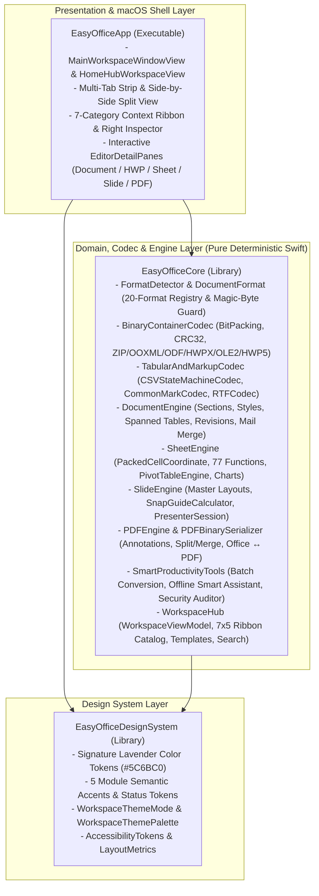

# EasyOffice 시스템 아키텍처 (System Architecture)

이 문서는 `EasyOffice` (`v1.0.0`)의 모듈 계층 구조, 비트 수준 컨테이너 코덱, 데이터 흐름, Fail-Closed 보안 경계, 결정론적 테스트 및 macOS 릴리스 패키징 아키텍처를 설명합니다.

---

## 1. 모듈 계층 구조 (Swift Package Architecture)



### 디렉터리 구조 (Directory Layout)

```text
EasyOffice/
├── Package.swift                                  # Swift 6 패키지 매니페스트 (macOS 14+)
├── Sources/
│   ├── EasyOfficeDesignSystem/                    # 시그니처 라벤더 디자인 시스템 및 레이아웃 토큰
│   │   └── DesignTokens.swift                     # RGBColorToken, WorkspaceThemeMode, AccessibilityTokens
│   ├── EasyOfficeCore/                            # 순수 결정론적 오피스 엔진, 코덱 및 스마트 생산성 코어
│   │   ├── DocumentFormat.swift                   # 20종 지원 포맷 레지스트리 및 ContainerFamily 메타데이터
│   │   ├── FormatDetector.swift                   # 매직 바이트 시그니처 검증 및 Fail-Closed 가드
│   │   ├── BinaryContainerCodec.swift             # BitPacking, Slicing-by-8 CRC32Calculator, ZipContainerCodec, XMLSanitizer
│   │   ├── StandardZipOfficeCodecs.swift          # OOXMLContainerCodec, ODFContainerCodec, HWPXContainerCodec
│   │   ├── OLE2AndLegacyOfficeCodecs.swift        # OLE2ContainerCodec, HWP5BinaryCodec, LegacyOLE2OfficeCodec (.doc/.xls/.ppt)
│   │   ├── TabularAndMarkupCodec.swift            # CSVStateMachineCodec, CommonMarkCodec, RTFCodec
│   │   ├── DocumentEngine.swift                   # 워드/한글(HWP/HWPX) 문서 모델, 인라인 런/이미지, 표 수식, 변경 추적, 메일 머지
│   │   ├── SheetEngine.swift                      # PackedCellCoordinate, FormulaAST, CellStyle, 다중 시트, evaluateGrid
│   │   ├── SheetBuiltInFunctions.swift            # 77종 스프레드시트 내장 함수 평가기 (수학·통계·논리·참조·텍스트·재무/날짜)
│   │   ├── SheetAnalyticsAndPivot.swift           # PivotTableEngine, SheetChartBuilder, 조건부 서식 및 유효성 검사
│   │   ├── SlideEngine.swift                      # 슬라이드/마스터, SnapGuideCalculator, PresenterSession 엔진
│   │   ├── PDFEngine.swift                        # 다중 페이지 PDF 분할/병합, 주석, 북마크, 양방향 변환 엔진
│   │   ├── PDFBinarySerializer.swift              # ISO 32000-1 바이트 정밀 xref 직렬화, 다중 줄 가시 스트림 및 PDFKit 브리지
│   │   ├── SmartProductivityTools.swift           # 일괄 변환 오케스트레이터 및 컨테이너 보안 감사기
│   │   ├── LocalSmartAssistant.swift              # 100% 오프라인 스마트 문서 보조 도구 (요약, 문장 진단, 액션 추출, LCS 비교)
│   │   ├── WorkspaceHub.swift                     # WorkspaceViewModel, Undo Coalescing, 파일 I/O, 찾기 및 바꾸기
│   │   └── WorkspaceRibbonCommandRouter.swift     # 140종 컨텍스트 리본 도메인 명령 라우터 (Zero-Slop 상태 변이)
│   └── EasyOfficeApp/                             # macOS 네이티브 SwiftUI + AppKit 애플리케이션
│       ├── EasyOfficeApp.swift                    # @main 앱 엔트리포인트 및 메뉴바 커맨드 (열기/저장/인쇄/찾기/복사/붙여넣기)
│       ├── WorkspaceViews.swift                   # 통합 타이틀바, 멀티 탭, 리본, 찾기/바꾸기 바, 스플릿 뷰, 좌/우 인스펙터
│       ├── HomeHubAndSmartViews.swift             # 홈 허브, 포맷 일괄 변환 스튜디오, 오프라인 스마트 문서 보조 스튜디오
│       ├── EditorDetailPanes.swift                # Document/HWP 인라인 런/이미지 편집기 및 Sheet 다중 시트/셀 서식 그리드
│       └── SlideAndPDFDetailPanes.swift           # Slide 드래그/리사이즈 스테이지 및 PDF Studio (PDFKit 메모이제이션 뷰)
├── Tests/
│   └── EasyOfficeTests/                           # 결정론적 단위·보안·UI 패리티 및 벤치마크 검증 스위트
│       ├── EasyOfficeTests.swift                  # 디자인 토큰, 포맷 카탈로그 및 기본 엔진 검증
│       ├── BinaryContainerCodecTests.swift        # BitPacking, CRC32, ZIP/OLE2/HWP5/CSV/MD/RTF 및 보안 가드 검증
│       ├── EditorEnginesParityTests.swift         # 77종 시트 함수, 피벗/차트, 문서/HWP, 슬라이드, PDF 패리티 검증
│       ├── SmartProductivityToolsTests.swift      # 일괄 변환, 오프라인 스마트 보조 도구 및 보안 감사기 검증
│       ├── WorkspaceUIParityTests.swift           # 스플릿 뷰, 7x5 리본 매트릭스, WCAG AA 및 접근성 검증
│       └── CommercialParityBenchmarkTests.swift   # 20종 포맷 라운드트립 매트릭스 및 비트 수준 처리량 벤치마크
├── Cargo.toml                                     # Rust 멀티 크레이트 워크스페이스 매니페스트 (macOS / Windows 공통 코어)
├── crates/
│   ├── easyoffice-formats/                        # 20종 포맷 시그니처 검증, ZIP/OLE2/HWP5/XML 보안 가드, CSV/MD/PDF 코덱
│   ├── easyoffice-sheet/                          # 64-bit 패킹 셀 좌표, 순환 참조 탐지 수식 파서/평가기, 피벗 요약 엔진
│   ├── easyoffice-layout/                         # 시그니처 라벤더 토큰, A4 다단/원고지, KS X 6101 공문서, 슬라이드/PDF 레이아웃
│   └── easyoffice-app/                            # Tauri v2 IPC 라우터, 크로스플랫폼 번들 설정(tauri.conf.json), WebUI(ui/)
├── scripts/
│   ├── check-repo-hygiene.mjs                     # 외부 서비스명·AI 흔적·필수 문서 무결성 가드
│   └── package-macos-release.sh                   # EasyOffice.app / .dmg / .zip / SHA256SUMS 생성기
├── docs/
│   ├── policy-decisions.md                        # 정책 결정 기록 (SSOT)
│   ├── design-system.md                           # 시그니처 라벤더 UI/UX 디자인 시스템
│   ├── product-spec.md                            # 올인원 오피스 통합 기능 명세
│   └── architecture.md                            # 시스템 아키텍처 문서
└── .github/
    ├── release.yml                                # GitHub Release 노트 자동 분류 설정
    ├── PULL_REQUEST_TEMPLATE.md                   # 자기완결 PR 표준 템플릿
    ├── ISSUE_TEMPLATE/                            # Epic / Task / Bug 이슈 폼 템플릿
    └── workflows/
        ├── ci.yml                                 # 위생 가드 + macOS Swift/Rust 빌드 + 테스트 게이트 (verify)
        ├── automerge.yml                          # automerge 라벨 기반 스쿼시 병합 및 이슈 자동 종료
        └── release.yml                            # 태그 기반 macOS .app/.dmg/.zip GitHub Release 발행
```

---

## 2. Mac·Windows 크로스플랫폼 Rust 멀티 크레이트 코어 및 Tauri v2 데스크톱 아키텍처

macOS와 Windows 양대 데스크톱 환경에서 동일한 문서 포맷 검증, 수식 계산, 조판 레이아웃, Fail-Closed 보안 불변식을 공유하기 위해 외부 런타임 의존성이 없는 순수 Rust 표준 라이브러리(`std`) 기반 4개 워크스페이스 크레이트와 Tauri v2 데스크톱 셸 계층을 함께 제공합니다.

1. **`crates/easyoffice-formats` (20종 포맷 레지스트리·컨테이너 보안 가드·직렬화 코덱)**:
   - 20종 `DocumentFormat` 및 `ContainerFamily` 메타데이터, 확장자-매직 바이트(`PK\x03\x04`, `\xD0\xCF\x11\xE0\xA1\xB1\x1A\xE1`, `%PDF-`, `{\rtf1`, UTF-8) 교차 검증(`FormatDetector::detect`, 최대 입력 `512 MiB`)을 수행합니다.
   - `ZipSecurityGuard::validate_archive_entries`는 엔트리 수(`4,096`), 단일 엔트리(`128 MiB`), 전체 해제 용량(`512 MiB`), 압축비(`100:1`), 경로 순회(`..`, 선행 `/`, `\`, NUL 바이트, Windows 드라이브 문자 `C:`)를 검증합니다.
   - `Ole2SecurityGuard`는 512바이트 섹터 정렬, DIFAT 헤더 상한(`109`), `HashSet<u32>` 기반 FAT 체인 순환 참조 탐지, HWP 5.0 `FileHeader` 암호화(`0x02`)·배포용 문서(`0x04`) 비트 차단을 수행합니다.
   - `XmlSanitizer`(`<!ENTITY` 및 외부 DTD `SYSTEM`/`PUBLIC`/`[` 차단), `CsvCodec`(RFC 4180 상태 기계), `CommonMarkCodec`, `PdfSerializer`(`%PDF-1.4` 바이트 오프셋 `xref` 직렬화)를 포함합니다.
2. **`crates/easyoffice-sheet` (64-bit 패킹 좌표·재귀 하강 수식 파서·$O(V+E)$ 평가기)**:
   - `PackedCellCoordinate`는 `(row: 32bit, col: 32bit)`를 단일 `u64`에 패킹하고(`MAX_ROWS = 1,000,000`, `MAX_COLS = 16,384`), `CellRange::expand`는 단일 범위 확장 상한(`100,000`셀)을 강제합니다.
   - 단항 `+`/`-`, 후위 `%`, 산술·비교·문자열 결합(`&`) 연산자, 순환 참조 탐지(`FormulaError::Cycle`) 및 재귀 상한(`MAX_RECURSION_DEPTH = 64`), ECMA-376 호환 `ISBLANK`·`SUM`·`AVERAGE`·`IF`·`IFERROR`·`SQRT`·`POWER`·`MOD`·`CONCAT`·`VLOOKUP`·`INDEX`·`MATCH`·`NPV`·`STDEV`·`MEDIAN` 등 내장 함수와 `PivotTableSummary` 집계를 제공합니다.
3. **`crates/easyoffice-layout` (시그니처 라벤더 토큰·문서/공문서/슬라이드/PDF 레이아웃)**:
   - `SignatureLavenderPalette`(`#5C6BC0` Primary Accent, `#F7F8FC` Light Canvas, `#141724` Dark Canvas)와 플랫폼 렌더러 식별자(`MacOsWkWebView` / `WindowsWebView2`)를 정의합니다.
   - `DocumentPageLayout`(A4 가로/세로 스왑, 1~4단 다단 폭 계산, 200자 원고지 그리드, KS X 6101 행정 공문서 헤더 및 결재란), `SlideStageLayout`(`840 × 472.5 pt` 16:9 스테이지 및 상단 본문·하단 오브젝트 비겹침 영역 `y >= 240pt`), `PdfStudioLayout`(`y = 804..452` 가시 좌표 및 결재 날인 박스)을 계산합니다.
4. **`crates/easyoffice-app` (Tauri v2 IPC 라우터·CLI 자체 검증·WebUI 셸)**:
   - `EasyOfficeIpcRouter::dispatch`가 `get_workspace_bootstrap`, `detect_format`, `evaluate_sheet`, `compute_layout`, `audit_security` 명령을 결정론적 JSON 페이로드로 라우팅하며, `cargo run -p easyoffice-app -- --self-test`로 전 크레이트 통합 불변식을 자체 검증합니다.
   - `tauri.conf.json`은 macOS(`.app`, `.dmg` — `WKWebView`)와 Windows(`.msi`, `.nsis` — `WebView2` `downloadBootstrapper`) 번들 타겟을 정의하고, `ui/{index.html,styles.css,app.js}`는 `Cmd`/`Ctrl` 단축키 자동 매핑과 한글 두벌식 IME 조합(`compositionstart`/`compositionupdate`/`compositionend`) 무결성을 지원합니다.

---

## 3. 보안 및 Fail-Closed 경계 (Security Boundaries)

1. **입구 시그니처 검증 (`FormatDetector`)**:
   - 모든 파일 입력은 확장자와 무관하게 바이트 헤더(`PK\x03\x04`, `\xD0\xCF\x11\xE0\xA1\xB1\x1A\xE1`, `%PDF-`, UTF-8 유효성)를 대조합니다.
   - 빈 파일(`emptyPayload`), 최대 허용 크기 초과(`payloadTooLarge`), 확장자-헤더 불일치(`signatureMismatch`)는 즉시 `EasyOfficeError`를 던져 차단합니다.
2. **ZIP/OLE2 압축 폭탄·경로 순회·XXE 원천 차단 (`ZipContainerCodec`, `OLE2ContainerCodec`, `XMLSanitizer`)**:
   - `ZipContainerSecurityPolicy`는 엔트리 수 상한(`4,096`), 단일 엔트리 해제 상한(`128 MiB`), 전체 해제 상한(`512 MiB`), 최대 압축 비율(`100:1`)을 강제하며, `..`·선행 `/`·`\`·NUL 바이트 경로를 `EasyOfficeError.securityViolation`으로, 압축 비율/용량 초과를 `EasyOfficeError.decompressionBombDetected`로 즉시 차단합니다.
   - `XMLSanitizer`는 컨테이너 내부 XML 파싱 전 `<!ENTITY` 선언 및 외부 DTD(`SYSTEM`/`PUBLIC`/내부 서브셋 `[`)를 검사하여 `EasyOfficeError.xxeOrExternalEntityDetected`로 차단합니다.
   - `OLE2ContainerCodec`과 `HWP5BinaryCodec`은 512바이트 섹터 FAT 체인 순환 루프를 방어하고, `FileHeader` 암호화 비트(`0x02`) 및 배포용 문서 비트(`0x04`) 감지 시 `EasyOfficeError.encryptedDocumentUnsupported`로 Fail-Closed 처리합니다.
3. **수식·범위 경계 및 스크립트 격리 (`SheetEngine`)**:
   - 스프레드시트 수식 평가기는 외부 셸 호출이나 네트워크 접근 권한이 없는 순수 메모리 내 평가기로 동작하며, `PackedCellCoordinate` 방문 집합과 재귀 상한(`maxRecursionDepth = 64`), 단일 범위 확장 상한(`maxExpandedCellCount = 100,000`)으로 무한 루프와 메모리 고갈을 차단합니다.
4. **메타데이터 비식별화 및 제로 외부 텔레메트리 (`DocumentSecurityAuditor`, `LocalSmartDocumentAssistant`)**:
   - 문서 요약, 문장 교정, 액션 아이템 추출, 시트 이상치 분석, 문서 비교(LCS), 일괄 변환, PII 비식별화(`scrubMetadata`)는 모두 100% 온디바이스 결정론적 알고리즘으로 수행되며 외부 네트워크 호출이나 텔레메트리 전송이 전혀 없습니다.

---

## 4. macOS 릴리스 패키징 파이프라인 (`scripts/package-macos-release.sh`)

GitHub Release 발행 시 `scripts/package-macos-release.sh`는 다음 단계를 결정론적으로 수행합니다:
1. `swift build -c release`로 최적화된 네이티브 실행 바이너리를 컴파일합니다.
2. 표준 macOS 애플리케이션 번들 구조(`EasyOffice.app/Contents/{MacOS,Resources,Info.plist,PkgInfo}`)를 생성하고 문서 확장자 연결(`CFBundleDocumentTypes`: `docx`, `xlsx`, `pptx`, `hwp`, `hwpx`, `pdf`, `odt`, `ods`, `odp`, `csv`, `md`, `txt`) 및 고해상도 Retina 속성(`NSHighResolutionCapable`)을 주입합니다.
3. 로컬 코드 서명(`codesign --force --deep --sign -` 또는 Developer ID 인증서) 및 번들 구조 검증을 수행합니다.
4. `hdiutil create`와 `ditto -c -k`를 사용하여 배포용 디스크 이미지(`EasyOffice-<version>-macos.dmg`), 압축 아카이브(`EasyOffice-<version>-macos.zip`), 그리고 `shasum -a 256` 기반의 `SHA256SUMS.txt`를 생성하여 GitHub Release 자산으로 업로드합니다.
