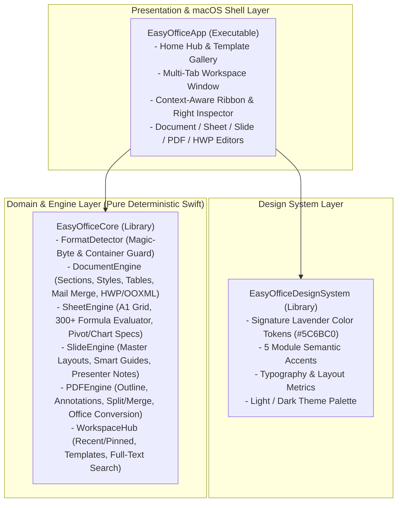

# EasyOffice 시스템 아키텍처 (System Architecture)

이 문서는 `EasyOffice`의 모듈 계층 구조, 데이터 흐름, 보안 경계, 결정론적 테스트 및 macOS 릴리스 패키징 아키텍처를 설명합니다.

---

## 1. 모듈 계층 구조 (Swift Package Architecture)



### 디렉터리 구조 (Directory Layout)

```text
EasyOffice/
├── Package.swift                        # Swift 6 패키지 매니페스트 (macOS 14+)
├── Sources/
│   ├── EasyOfficeDesignSystem/          # 시그니처 라벤더 디자인 시스템 및 레이아웃 토큰
│   │   └── DesignTokens.swift
│   ├── EasyOfficeCore/                  # 순수 결정론적 오피스 엔진 코어
│   │   ├── DocumentFormat.swift         # 지원 포맷 레지스트리 및 메타데이터
│   │   ├── FormatDetector.swift         # 매직 바이트 시그니처 검증 및 Fail-Closed 가드
│   │   ├── DocumentEngine.swift         # 워드/한글(HWP/HWPX) 문서 모델, 통계, 메일 머지
│   │   ├── SheetEngine.swift            # 스프레드시트 셀/범위 파서 및 수식 계산 엔진
│   │   ├── SlideEngine.swift            # 프레젠테이션 슬라이드/마스터/발표자 노트 엔진
│   │   ├── PDFEngine.swift              # PDF 주석, 페이지 조작, 양방향 변환 엔진
│   │   └── WorkspaceHub.swift           # 통합 홈 허브, 템플릿 갤러리, 전문 검색 엔진
│   └── EasyOfficeApp/                   # macOS 네이티브 SwiftUI + AppKit 애플리케이션
│       ├── EasyOfficeApp.swift          # @main 앱 엔트리포인트 및 메뉴바 커맨드
│       └── WorkspaceViews.swift         # 홈 허브, 멀티 탭, 리본, 5대 에디터 뷰, 인스펙터
├── Tests/
│   └── EasyOfficeTests/                 # 결정론적 단위 및 통합 검증 스위트
│       └── EasyOfficeTests.swift
├── scripts/
│   ├── check-repo-hygiene.mjs           # 외부 서비스명·AI 흔적·필수 문서 무결성 가드
│   └── package-macos-release.sh         # EasyOffice.app / .dmg / .zip / SHA256SUMS 생성기
├── docs/
│   ├── policy-decisions.md              # 정책 결정 기록 (SSOT)
│   ├── design-system.md                 # 시그니처 라벤더 UI/UX 디자인 시스템
│   ├── product-spec.md                  # 올인원 오피스 통합 기능 명세
│   └── architecture.md                  # 시스템 아키텍처 문서
└── .github/
    ├── release.yml                      # GitHub Release 노트 자동 분류 설정
    ├── PULL_REQUEST_TEMPLATE.md         # 자기완결 PR 표준 템플릿
    ├── ISSUE_TEMPLATE/                  # Epic / Task / Bug 이슈 폼 템플릿
    └── workflows/
        ├── ci.yml                       # 위생 가드 + macOS 빌드 + 테스트 게이트 (verify)
        ├── automerge.yml                # automerge 라벨 기반 스쿼시 병합 및 이슈 자동 종료
        └── release.yml                  # 태그 기반 macOS .app/.dmg/.zip GitHub Release 발행
```

---

## 2. 보안 및 Fail-Closed 경계 (Security Boundaries)

1. **입구 시그니처 검증 (`FormatDetector`)**:
   - 모든 파일 입력은 확장자와 무관하게 바이트 헤더(`PK\x03\x04`, `\xD0\xCF\x11\xE0\xA1\xB1\x1A\xE1`, `%PDF-`, UTF-8 유효성)를 대조합니다.
   - 빈 파일, 최대 허용 크기 초과, 확장자-헤더 불일치(예: `.pdf` 확장자이나 내부가 임의 바이너리인 경우)는 즉시 `EasyOfficeError`를 던져 차단합니다.
2. **수식 및 스크립트 격리 (`SheetEngine`)**:
   - 스프레드시트 수식 평가기는 외부 셸 호출이나 네트워크 접근 권한이 전혀 없는 순수 메모리 내 AST 평가기로 동작하며, 0으로 나누기(`#DIV/0!`), 잘못된 참조(`#REF!`), 알 수 없는 함수(`#NAME?`)를 크래시 없이 결정론적 에러 셀 값으로 반환합니다.
3. **제로 외부 텔레메트리**:
   - 사용자의 문서 본문, 템플릿, 검색 색인은 로컬 샌드박스 내부에서만 처리되며 외부 서버로 무단 전송되지 않습니다.

---

## 3. macOS 릴리스 패키징 파이프라인 (`scripts/package-macos-release.sh`)

GitHub Release 발행 시 `scripts/package-macos-release.sh`는 다음 단계를 결정론적으로 수행합니다:
1. `swift build -c release`로 최적화된 네이티브 실행 바이너리를 컴파일합니다.
2. 표준 macOS 애플리케이션 번들 구조(`EasyOffice.app/Contents/{MacOS,Resources,Info.plist,PkgInfo}`)를 생성하고 문서 확장자 연결(`CFBundleDocumentTypes`: `docx`, `xlsx`, `pptx`, `hwp`, `hwpx`, `pdf`, `odt`, `ods`, `odp`, `csv`, `md`, `txt`) 및 고해상도 Retina 속성(`NSHighResolutionCapable`)을 주입합니다.
3. 로컬 코드 서명(`codesign --force --deep --sign -` 또는 Developer ID 인증서) 및 번들 구조 검증을 수행합니다.
4. `hdiutil create`와 `ditto -c -k`를 사용하여 배포용 디스크 이미지(`EasyOffice-<version>-macos.dmg`), 압축 아카이브(`EasyOffice-<version>-macos.zip`), 그리고 `shasum -a 256` 기반의 `SHA256SUMS.txt`를 생성하여 GitHub Release 자산으로 업로드합니다.
