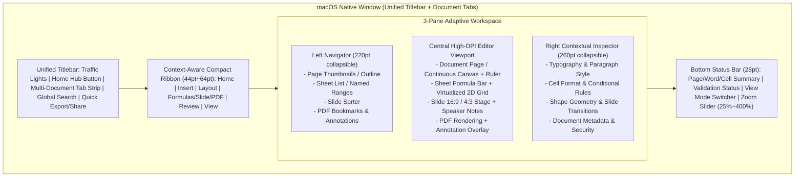

# EasyOffice UI/UX & Signature Lavender Design System

이 문서는 `EasyOffice`의 시각적 정체성("우리의 결")인 **Signature Lavender Design System**과 상용 올인원 오피스 스위트의 사용성을 결합한 macOS 네이티브 UI/UX 설계 기준을 정의합니다.

---

## 1. 디자인 철학 (Core Design Principles)

1. **Signature Lavender Identity ("우리의 결")**:
   - 브랜드 고유의 차분하고 정교한 라벤더/인디고 컬러 스케일(`#5C6BC0` Primary Accent, `#F7F8FC` Cool Alabaster Light Scaffold, `#141724` Indigo-Tinted Charcoal Dark Scaffold)을 애플리케이션 전반의 포커스 링, 활성 탭, 기본 CTA, 선택 영역에 일관되게 적용합니다.
2. **Instant Format Recognition (0.1초 문서 유형 인지)**:
   - 올인원 오피스 특성상 한 윈도우에 워드 문서, 스프레드시트, 프레젠테이션, 한글(HWP/HWPX), PDF가 동시에 열리므로, 라벤더 팔레트와 조화를 이루는 **5대 모듈 시맨틱 액센트**를 탭 배지, 파일 아이콘, 상태 표시줄에 부여합니다.
3. **macOS Native Ergonomics + Familiar Office Ribbon**:
   - macOS 사용자가 기대하는 네이티브 타이틀바/탭, 사이드바 반투명 비브런시(Vibrancy), 시스템 다크모드, 트랙패드 핀치 줌, VoiceOver 접근성을 100% 준수합니다.
   - 동시에 올인원 오피스 숙련 사용자에게 친숙한 **상단 컨텍스트 리본(Context-Aware Ribbon)**과 **우측 세부 속성 인스펙터(Contextual Inspector)**를 결합하여 어떤 기능도 2클릭 이내에 접근할 수 있게 설계합니다.

---

## 2. 컬러 토큰 명세 (Color Tokens)

### 2.1 Signature Brand Lavender Scale
| Token | Hex | 용도 |
| :--- | :--- | :--- |
| `brand-50` | `#F8F9FF` | 선택된 셀/단락 미세 배경 하이라이트 (Light) |
| `brand-100` | `#F0F2FE` | 리본 활성 도구 버튼 배경, 템플릿 카드 호버 표면 |
| `brand-200` | `#E2E5FD` | 활성 요소 보더 및 뱃지 배경 |
| `brand-300` | `#CCD2FC` | 다크모드 보조 포커스 링 및 아이콘 액센트 |
| `brand-400` | `#B4BCFB` | 다크모드 활성 텍스트/아이콘 하이라이트 |
| `brand-500` | `#8E9CE6` | 보조 인터랙션 및 차트 기본 시리즈 색상 |
| `brand-600` | `#7480D2` | 다크모드 기본 CTA 버튼 배경 |
| `brand-700` | `#5C6BC0` | **Primary Signature Accent** (기본 CTA, 포커스 링, 활성 탭 인디케이터) |
| `brand-800` | `#4A58A9` | Primary 버튼 Hover / Pressed 상태 |
| `brand-900` | `#3B4890` | 고대비 보더 및 강조 텍스트 |
| `brand-950` | `#1F2340` | 기본 본문 잉크 색상 (`ink-primary`) |

### 2.2 Neutral & Dark Mode Surfaces
| 구분 | Token | Light Mode | Dark Mode | 용도 |
| :--- | :--- | :--- | :--- | :--- |
| **Window Scaffold** | `surface-scaffold` | `#F7F8FC` | `#141724` | 앱 전체 배경 및 캔버스 바깥 여백(Pasteboard) |
| **Elevated Panel** | `surface-panel` | `#FFFFFF` | `#1B2032` | 리본 바, 좌/우 인스펙터, 홈 허브 카드 표면 |
| **Subtle Group** | `surface-subtle` | `#F0F2F7` | `#242B42` | 툴바 그룹 컨테이너, 입력 필드 배경 |
| **Divider / Border** | `border-hairline` | `#E1E4EE` | `#2C3452` | 1pt 픽셀 정렬 구분선 및 그리드 보더 |
| **Primary Text** | `ink-primary` | `#1F2340` | `#F8F9FD` | 제목, 본문, 도구 레이블 |
| **Secondary Text** | `ink-secondary` | `#4D536B` | `#B8C0DC` | 보조 설명, 비활성 탭 레이블 |
| **Muted Text** | `ink-muted` | `#697089` | `#8A94B8` | 눈금자 수치, 상태바 메타데이터, 단축키 힌트 |

### 2.3 Module Semantic Accents (5대 오피스 모듈 식별 컬러)
| 모듈 | Token | Light Hex | Soft Badge | 대상 확장자 |
| :--- | :--- | :--- | :--- | :--- |
| **Document (워드)** | `module-document` | `#5C6BC0` | `#F0F2FE` | `.docx`, `.doc`, `.odt`, `.rtf`, `.md`, `.txt` |
| **Sheet (시트)** | `module-sheet` | `#0A705A` | `#F0FBF7` | `.xlsx`, `.xls`, `.ods`, `.csv`, `.tsv` |
| **Slide (슬라이드)** | `module-slide` | `#D96B27` | `#FFF4EC` | `.pptx`, `.ppt`, `.odp`, `.ppsx` |
| **HWP (한글 문서)** | `module-hwp` | `#6E56CF` | `#F3F0FF` | `.hwp`, `.hwpx`, `.hwt`, `.hwtx` |
| **PDF Studio** | `module-pdf` | `#D9383A` | `#FEE2E2` | `.pdf` |

---

## 3. 워크스페이스 레이아웃 아키텍처 (Workspace Layout)

### 3.1 통합 홈 허브 (Home Hub)
- **좌측 사이드바 (macOS Sidebar Vibrancy)**:
  - `홈 (Home)`: 빠른 새 문서 생성 카드(문서, 시트, 슬라이드, 한글 문서, PDF 열기) + 최근 작업 문서 및 고정(Pinned) 문서 목록
  - `서식 템플릿 (Templates)`: 보고서, 기획서, 이력서, 공문서(HWPX/DOCX), 재무제표/가계부/일정표(XLSX), 피치덱/발표자료(PPTX) 내장 템플릿 갤러리
  - `통합 검색 (Unified Search)`: 파일명뿐 아니라 열람 이력이 있는 문서 본문·셀·슬라이드 노트 텍스트까지 즉시 필터링
  - `포맷 일괄 변환 (Batch Converter)`: `DOCX/HWP/HWPX/XLSX/PPTX ↔ PDF`, `XLSX ↔ CSV`, `DOCX ↔ MD/TXT` 드래그 앤 드롭 변환 스튜디오

### 3.2 에디터 워크스페이스 (Editor Workspace)
- **컴팩트 컨텍스트 리본 (Compact Context-Aware Ribbon)**:
  - 현재 활성화된 문서 탭의 유형(`Document`, `Sheet`, `Slide`, `HWP`, `PDF`)에 맞춰 상단 리본 탭 구성이 즉시 전환됩니다.
  - 화면 공간 절약을 위해 리본 접기/펼치기(`Cmd+Option+R`)를 지원하며, 접힌 상태에서도 핵심 서식 도구 모음은 1줄(44pt)로 유지됩니다.
- **우측 세부 속성 인스펙터 (Right Contextual Inspector)**:
  - 리본에 모든 세부 옵션을 우겨넣어 화면이 복잡해지는 문제를 방지하기 위해, 글꼴 자간/장평, 표 테두리/셀 여백, 조건부 서식, 도형 그림자/정렬, 슬라이드 애니메이션 타이밍 등 정밀 제어는 우측 인스펙터 패널에서 실시간 미리보기와 함께 조작합니다.
- **멀티 탭 및 분할 보기 (Multi-Tab & Split View)**:
  - 서로 다른 포맷의 문서들을 단일 윈도우의 상단 탭 스트립에 나란히 열어 전환하거나, 좌우 분할 보기(Split View)로 PDF 참고 자료와 워드/한글 문서를 동시에 보며 작업할 수 있습니다.
