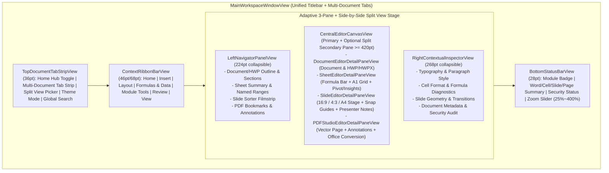

# EasyOffice UI/UX & Signature Lavender Design System

이 문서는 `EasyOffice` (`v1.0.0`)의 시각적 정체성("우리의 결")인 **Signature Lavender Design System**(`Sources/EasyOfficeDesignSystem/DesignTokens.swift`)과 macOS 네이티브 올인원 오피스 워크스페이스의 UI/UX 설계 기준을 정의합니다.

---

## 1. 디자인 철학 (Core Design Principles)

1. **Signature Lavender Identity ("우리의 결")**:
   - 브랜드 고유의 차분하고 정교한 라벤더/인디고 컬러 스케일(`#5C6BC0` Primary Accent, `#F7F8FC` Cool Alabaster Light Scaffold, `#141724` Indigo-Tinted Charcoal Dark Scaffold)을 애플리케이션 전반의 포커스 링, 활성 탭, 기본 CTA, 선택 영역에 일관되게 적용합니다.
2. **Instant Format Recognition (0.1초 문서 유형 인지)**:
   - 올인원 오피스 특성상 한 윈도우에 워드 문서, 스프레드시트, 프레젠테이션, 한글(HWP/HWPX), PDF가 동시에 열리므로, 라벤더 팔레트와 조화를 이루는 **5대 모듈 시맨틱 액센트**(`OfficeModuleKind`)를 탭 배지(`DOC`, `HWP`, `SHEET`, `SLIDE`, `PDF`), 파일 아이콘, 상태 표시줄에 부여합니다.
3. **macOS Native Ergonomics + Context-Aware Compact Ribbon**:
   - macOS 사용자가 기대하는 네이티브 타이틀바/탭, 사이드바 반투명 비브런시(Vibrancy), 3종 테마 모드(`WorkspaceThemeMode`: `.system`, `.lightLavender`, `.darkIndigo`), 트랙패드 줌(`25%~400%`), VoiceOver 접근성(`AccessibilityTokens`)을 100% 준수합니다.
   - 동시에 올인원 오피스 숙련 사용자에게 친숙한 **7대 카테고리 컨텍스트 리본(`RibbonCategory`)**과 **우측 세부 속성 인스펙터(`RightContextualInspectorView`)**를 결합하여 어떤 기능도 2클릭 이내에 접근할 수 있게 설계합니다.

---

## 2. 컬러 토큰 및 레이아웃 메트릭 명세 (`EasyOfficeDesignTokens`)

### 2.1 Signature Brand Lavender Scale
| Token | Swift Symbol | Hex | 용도 |
| :--- | :--- | :--- | :--- |
| `brand-50` | `EasyOfficeDesignTokens.brand50` | `#F8F9FF` | 선택된 셀/단락 미세 배경 하이라이트 (Light) |
| `brand-100` | `EasyOfficeDesignTokens.brand100` | `#F0F2FE` | 리본 활성 도구 버튼 배경, 템플릿 카드 호버 표면 |
| `brand-200` | `EasyOfficeDesignTokens.brand200` | `#E2E5FD` | 활성 요소 보더 및 뱃지 배경 |
| `brand-300` | `EasyOfficeDesignTokens.brand300` | `#CCD2FC` | 다크모드 보조 포커스 링 및 아이콘 액센트 |
| `brand-400` | `EasyOfficeDesignTokens.brand400` | `#B4BCFB` | 다크모드 활성 텍스트/아이콘 하이라이트 |
| `brand-500` | `EasyOfficeDesignTokens.brand500` | `#8E9CE6` | 보조 인터랙션 및 차트 기본 시리즈 색상 |
| `brand-600` | `EasyOfficeDesignTokens.brand600` | `#7480D2` | 다크모드 기본 CTA 버튼 배경 |
| `brand-700` | `EasyOfficeDesignTokens.brand700` | `#5C6BC0` | **Primary Signature Accent** (기본 CTA, 포커스 링, 활성 탭 인디케이터) |
| `brand-800` | `EasyOfficeDesignTokens.brand800` | `#4A58A9` | Primary 버튼 Hover / Pressed 상태 |
| `brand-900` | `EasyOfficeDesignTokens.brand900` | `#3B4890` | 고대비 보더 및 강조 텍스트 |
| `brand-950` | `EasyOfficeDesignTokens.brand950` | `#1F2340` | 기본 본문 잉크 색상 (`inkPrimary`) |

### 2.2 Neutral & Dark Mode Surfaces (`WorkspaceThemePalette`)
| 구분 | Token | Light Mode (`lightLavender`) | Dark Mode (`darkIndigo`) | 용도 |
| :--- | :--- | :--- | :--- | :--- |
| **Window Scaffold** | `background` | `#F7F8FC` (`lightScaffold`) | `#141724` (`darkScaffold`) | 앱 전체 배경 및 캔버스 바깥 여백(Pasteboard) |
| **Card Surface** | `cardSurface` | `#FFFFFF` (`lightWhite`) | `#1B2032` (`darkSurface`) | 리본 바, 좌/우 인스펙터, 홈 허브 카드 표면 |
| **Elevated Surface** | `elevatedSurface` | `#F0F2F7` (`lightSubtle`) | `#242B42` (`darkElevated`) | 툴바 그룹 컨테이너, 입력 필드 배경 |
| **Divider / Border** | `border` | `#E1E4EE` (`lightBorder`) | `#2C3452` (`darkBorder`) | 1pt 픽셀 정렬 구분선 및 그리드 보더 |
| **Primary Text** | `primaryText` | `#1F2340` (`inkPrimary`) | `#F8F9FD` (`darkText`) | 제목, 본문, 도구 레이블 (WCAG AA `>= 4.5:1`) |
| **Secondary Text** | `secondaryText` | `#4D536B` (`inkSecondary`) | `#8A94B8` (`darkMuted`) | 보조 설명, 비활성 탭 레이블 |
| **Muted Text** | `inkMuted` | `#697089` (`inkMuted`) | `#8A94B8` (`darkMuted`) | 눈금자 수치, 상태바 메타데이터, 단축키 힌트 |

### 2.3 Module Semantic Accents & Status Tokens
| 구분 | Swift Symbol | Light Hex | Soft Badge | 대상 확장자 / 의미 |
| :--- | :--- | :--- | :--- | :--- |
| **Document (워드)** | `accentToken(for: .document)` | `#5C6BC0` | `#F0F2FE` | `.docx`, `.doc`, `.odt`, `.rtf`, `.md`, `.txt` |
| **HWP (한글 문서)** | `accentToken(for: .hwp)` | `#6E56CF` | `#F3F0FF` | `.hwp`, `.hwpx`, `.hwt`, `.hwtx` |
| **Sheet (시트)** | `accentToken(for: .sheet)` | `#0A705A` | `#F0FBF7` | `.xlsx`, `.xls`, `.ods`, `.csv`, `.tsv` |
| **Slide (슬라이드)** | `accentToken(for: .slide)` | `#D96B27` | `#FFF4EC` | `.pptx`, `.ppt`, `.odp`, `.ppsx` |
| **PDF Studio** | `accentToken(for: .pdf)` | `#D9383A` | `#FEE2E2` | `.pdf` |
| **Status Success** | `EasyOfficeDesignTokens.statusSuccess` | `#0A705A` | - | 매직 시그니처 검증 통과 / 정상 상태 (WCAG AA) |
| **Status Warning** | `EasyOfficeDesignTokens.statusWarning` | `#B45309` | - | 주의 / 검토 권장 상태 (WCAG AA) |
| **Status Danger** | `EasyOfficeDesignTokens.statusDanger` | `#C81E1E` | - | 보안 위협 / 수식·컨테이너 오류 상태 (WCAG AA) |
| **Status Info** | `EasyOfficeDesignTokens.statusInfo` | `#4A58A9` | - | 정보 안내 / 보조 인디케이터 (WCAG AA) |

### 2.4 macOS Workspace Layout Metrics (`EasyOfficeDesignTokens.LayoutMetrics`)
| Metric Symbol | Value | 설명 |
| :--- | :--- | :--- |
| `tabStripHeight` | `36pt` | 상단 멀티 문서 탭 스트립 높이 |
| `compactRibbonHeight` | `46pt` | 리본 접힘(`isRibbonCollapsed == true`) 상태 1줄 높이 |
| `expandedRibbonHeight` | `68pt` | 리본 펼침(`isRibbonCollapsed == false`) 상태 기본 높이 |
| `leftNavigatorWidth` | `224pt` | 좌측 구조 내비게이터 패널 기본 너비 |
| `rightInspectorWidth` | `268pt` | 우측 세부 속성 인스펙터 패널 기본 너비 |
| `statusBarHeight` | `28pt` | 하단 상태 및 줌 슬라이더 바 높이 |
| `minimumWindowWidth` / `Height` | `1120pt` × `740pt` | macOS 메인 워크스페이스 최소 윈도우 크기 |
| `splitPaneMinimumWidth` | `420pt` | 스플릿 뷰(Split View) 단일 편집 캔버스 최소 보장 너비 |
| `formulaBarHeight` | `34pt` | 스프레드시트 수식 입력줄(`fx`) 높이 |
| `slideFilmstripWidth` | `210pt` | 프레젠테이션 좌측 슬라이드 필름스트립 너비 |

---

## 3. 워크스페이스 레이아웃 아키텍처 (`WorkspaceViews.swift`, `EditorDetailPanes.swift`)

### 3.1 통합 홈 허브 (`HomeHubWorkspaceView`, `HubSection`)
- **6대 섹션 사이드바 (`HubSection`)**:
  - `홈 (home)`: 5대 모듈 빠른 새 문서 생성 카드 + 최근/고정 문서 요약
  - `최근 문서 (recent)`: 마지막 열람 시각(`lastOpenedISO8601`) 역순 정렬 문서 목록
  - `고정/즐겨찾기 (pinned)`: 상단 고정(`isPinned`) 및 즐겨찾기(`isFavorite`) 문서 모아보기
  - `서식 템플릿 (templates)`: 공문서(HWPX), 협조전(HWP), 연간 보고서(DOCX), 예산안(XLSX), KPI 시트(ODS), 제품 발표덱(PPTX), 세미나 덱(ODP), 계약서 검토(PDF) 등 8종 내장 템플릿 및 사용자 정의 템플릿(`saveActiveTabAsCustomTemplate`)
  - `일괄 변환 스튜디오 (converter)`: `DocumentConversionOrchestrator` 연동 20종 포맷 일괄 변환 및 매직 시그니처 검증 결과 리포트
  - `스마트 보조 도구 (smartAssistant)`: `LocalSmartDocumentAssistant` 및 `DocumentSecurityAuditor` 기반 오프라인 요약·교정·조치 항목·시트 인사이트·문서 비교·보안 감사 패널

### 3.2 에디터 워크스페이스 및 접근성 (`EditorDetailPanes.swift`, `AccessibilityTokens`)
- **7대 컨텍스트 리본 카테고리 (`RibbonCategory`)**:
  - `홈 (home)`, `삽입 (insert)`, `레이아웃 (layout)`, `수식·데이터 (formulasAndData)`, `모듈 전용 (moduleSpecific)`, `검토·보안 (review)`, `보기·창 (view)`의 7개 카테고리가 5대 오피스 모듈(`OfficeModuleKind`)별로 빈 슬롯 없이 최적화된 명령(`RibbonCommandDescriptor`)을 노출합니다.
  - 리본 접기/펼치기(`Cmd+Option+R`) 토글 시 `68pt` 확장 리본과 `46pt` 1줄 컴팩트 모드로 즉시 전환됩니다.
- **스플릿 뷰 (Side-by-Side Split View)**:
  - `WorkspaceViewModel.enableSplitView(secondaryTabID:)`를 통해 단일 윈도우에서 서로 다른 두 문서 탭(예: 좌측 `PDF` 참고 자료 + 우측 `HWPX` 공문서, 또는 좌측 `XLSX` 재무 시트 + 우측 `PPTX` 발표덱)을 나란히 열고 동시 편집할 수 있습니다.
- **VoiceOver 및 키보드 접근성 (`AccessibilityTokens`)**:
  - 탭 레이블(`tabLabel(fileName:moduleName:isPinned:isFavorite:)`, `tabSelectHint`, `tabPinLabel`), 리본 토글 레이블(`ribbonCollapseLabel`, `ribbonExpandLabel`), 분할 보기 캔버스 레이블(`splitViewCanvasLabel`), 수식 입력줄 레이블(`formulaBarInputLabel`), 슬라이드 캔버스 레이블(`slideStageLabel`), PDF 주석 도구 모음 레이블(`pdfAnnotationToolbarLabel`)을 결정론적으로 제공합니다.
